# Урок 1. Комп’ютерна графіка

**Як працювати з уроком**

1. Прочитайте теорію. Сторінку «Детальніше» відкривайте, якщо цікаво.
2. Перегляньте анімації: кожна показує одну дію крок за кроком.
3. Пройдіть [тест](#тест) (10 запитань). На початку вкажіть прізвище, ім’я та групу.
4. За бажанням виконайте [додаткове завдання](#додаткове-завдання). Воно необов’язкове, але якщо ви його надішлете, воно буде оцінене.

## Мета уроку

Ви дізнаєтеся, з чого складається цифрове зображення, і навчитеся в програмі **Krita**:

- малювати пензлем, фігурами та заливкою;
- працювати з шарами й додавати текст;
- обрізати фото, змінювати його розмір і яскравість;
- правильно зберігати результат.

## Що знадобиться

- Програма **Krita**: безкоштовна, з відкритим кодом. Завантажити можна з офіційного сайту **krita.org** (розділ Download).
- Фото для вправ: [photo.jpg](files/photo.jpg) (Карпати; автор Roman Zacharij, суспільне надбання, Wikimedia Commons).

> На Windows вікна вибору файлу виглядають трохи інакше, ніж на анімаціях. Усе інше в Krita однакове.

## Теорія

**Піксель.** Фото на екрані складається з дуже дрібних квадратиків — **пікселів**. Кожен піксель має один колір. Якщо сильно збільшити фото, пікселі стає видно.

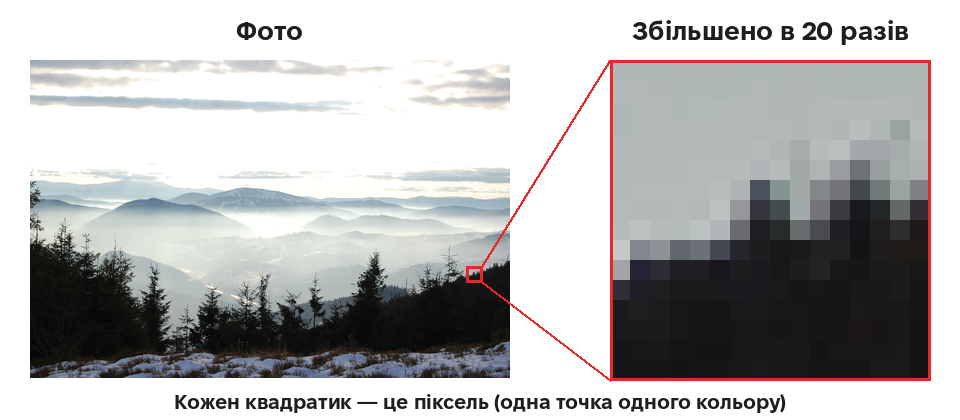

**Растрова і векторна графіка.**

- **Растрова** картинка складається з пікселів: це фото, малюнки в Krita. Якщо її сильно збільшити, вона стає «квадратною» і розмитою.
- **Векторна** картинка зберігає лінії й фігури як формули: це логотипи, значки, креслення. Її можна збільшувати без втрати якості.

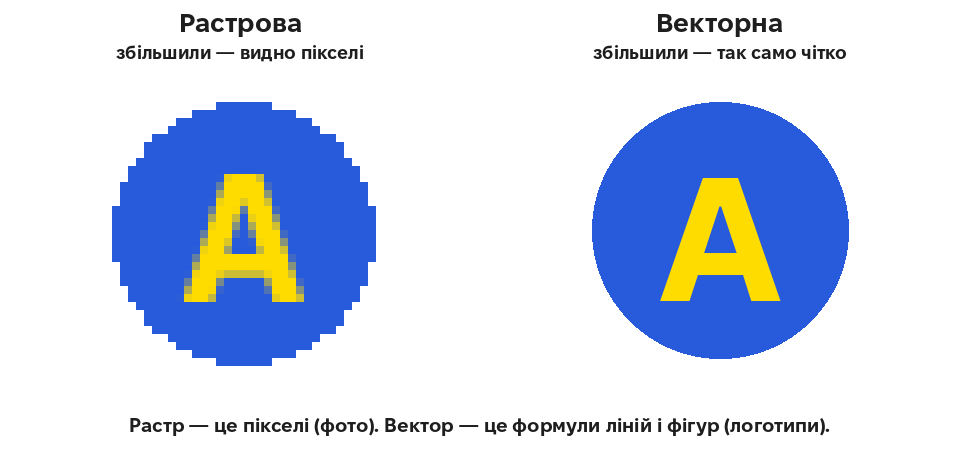

**Шари** — це ніби прозорі плівки, покладені одна на одну. Малюнок на одному шарі можна змінювати, ховати або стирати, не зачіпаючи інших шарів.

**Формати файлів**

| Формат | Для чого | Що варто знати |
|---|---|---|
| **JPG** | фото | файл маленький, але прозорості немає |
| **PNG** | малюнки, значки, скриншоти | підтримує прозорість, чіткі краї |
| **KRA** | робочий файл Krita | зберігає всі шари, щоб редагувати далі |

**Зберегти чи експортувати?**

- **Зберегти** (у форматі `.kra`) означає зберегти робочий проєкт з усіма шарами.
- **Експортувати** (у `.jpg` або `.png`) означає отримати готову картинку, щоб надіслати чи опублікувати.

**Хочете знати більше?** Необов’язково

На сторінці [**Детальніше**](more.md) — з прикладами, діаграмами й посиланнями на джерела:

- що саме зберігає піксель і як записують кольори;
- чим екран відрізняється від принтера (RGB і CMYK);
- скільки пікселів потрібно для друку;
- як стиснення впливає на розмір файлу і якість;
- який формат обрати;
- що таке SVG;
- навіщо художникам графічний планшет;
- де брати зображення законно.

У тесті цього матеріалу немає.

## Покроково

### 1. Вікно програми

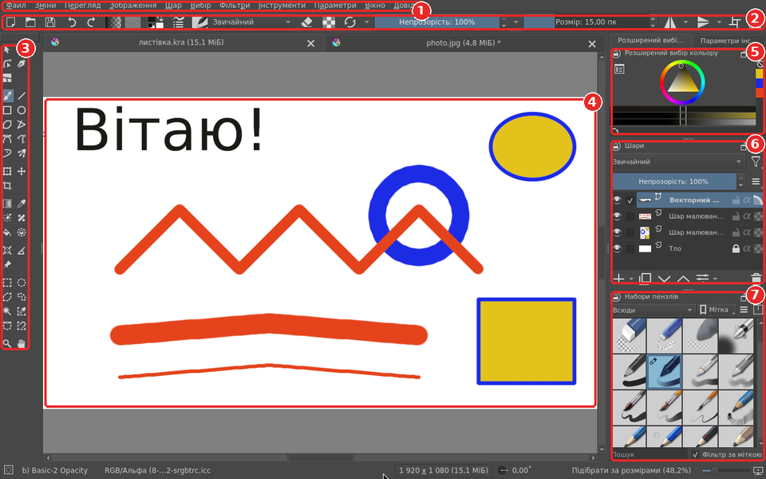

1. **Меню**: усі команди програми.
2. **Панель параметрів пензля**: колір, вид пензля, непрозорість, розмір.
3. **Панель інструментів**: пензель, фігури, заливка, текст, кадрування та інші.
4. **Полотно**: тут ви малюєте.
5. **Вибір кольору**.
6. **Шари**.
7. **Набори пензлів**: різні види пензлів, олівців і маркерів.

### 2. Нове полотно

Відкрийте **Файл → Створити…**, вкажіть ширину й висоту в пікселях (наприклад, 1920 × 1080) і натисніть **Створити**.

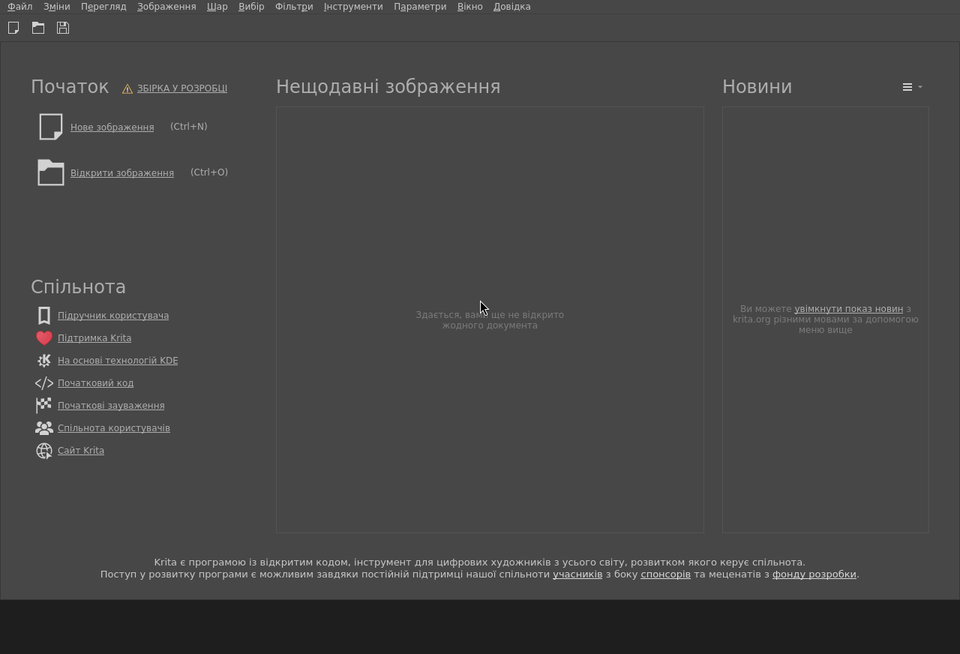

### 3. Пензель і колір

Оберіть інструмент **Пензель**, потім вид пензля на панелі «Набори пензлів». Колір оберіть на колі, а його відтінок — у трикутнику всередині. Малюйте, утримуючи ліву кнопку миші.

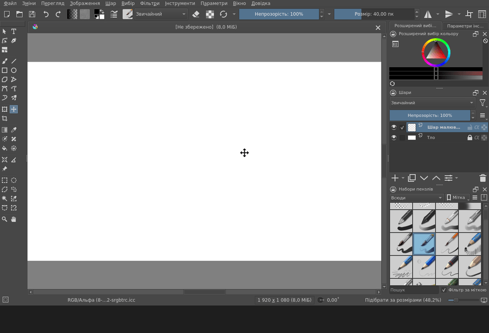

### 4. Розмір пензля

Потягніть повзунок **Розмір** праворуч, щоб лінія стала товщою, або ліворуч, щоб тоншою.

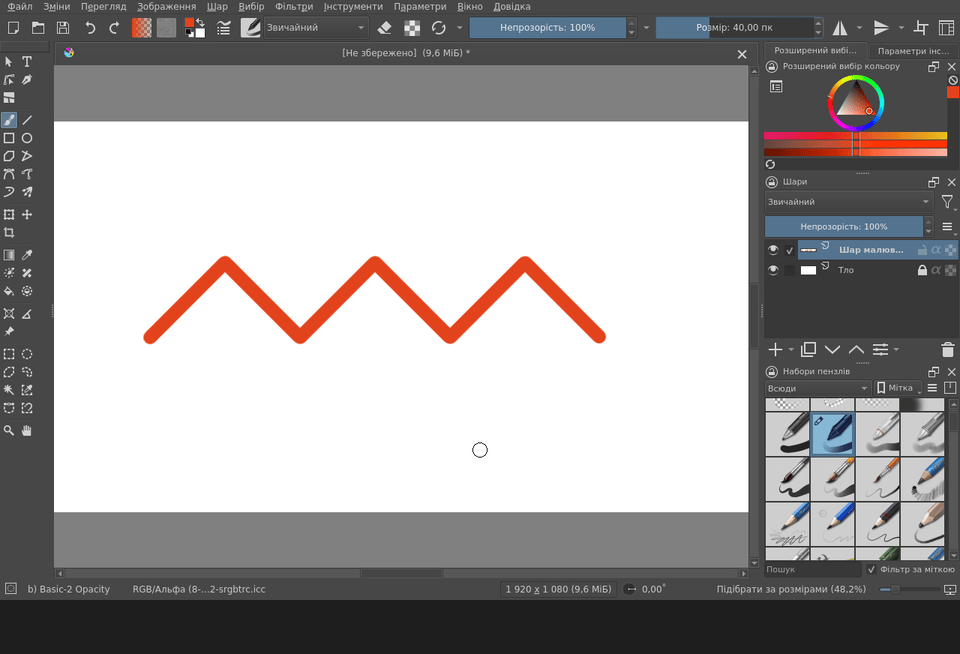

### 5. Гумка і скасування дії

Кнопка з гумкою (або клавіша **E**) перетворює пензель на гумку. Якщо щось пішло не так, натисніть **Ctrl+Z**: це скасовує останню дію. Натисніть кілька разів, щоб скасувати кілька дій.

### 6. Шари

Кнопка **«+»** на панелі «Шари» додає новий шар. Значок **«око»** ховає шар і показує його знову. Стрілки переміщують шар вище або нижче: те, що вище, закриває те, що нижче.

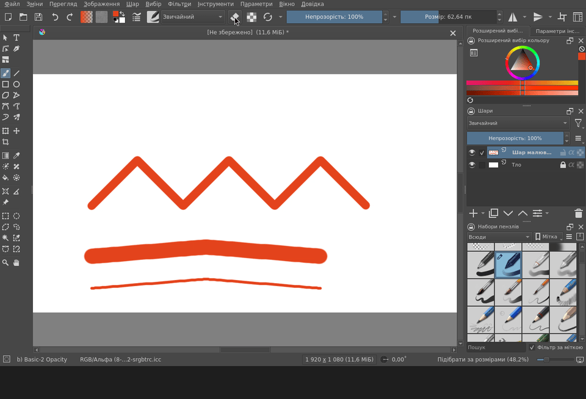

### 7. Фігури

Інструменти **Прямокутник** і **Еліпс**: протягніть мишею від одного кута фігури до протилежного.

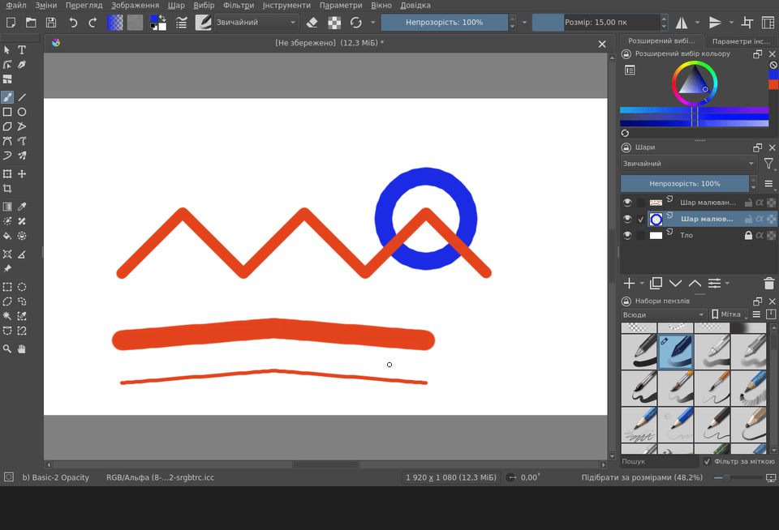

### 8. Заливка

Інструмент **Заливка** (відерце) зафарбовує замкнену область. Оберіть колір і клацніть усередині фігури.

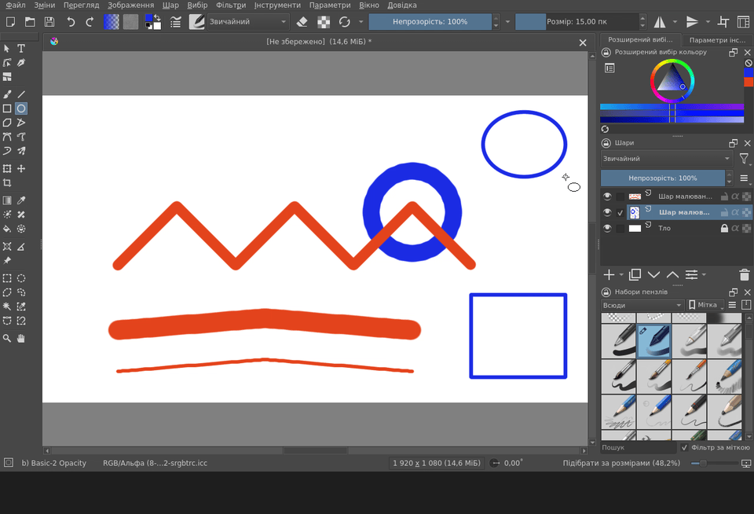

### 9. Текст

Оберіть колір, потім інструмент **Текст**, протягніть рамку й надрукуйте текст. Щоб змінити розмір літер:

1. Виділіть текст клавішами **Ctrl+A**.
2. Відкрийте **Параметри інструмента → Відкрити властивості тексту**.
3. На вкладці **Символ** змініть **Розмір шрифту**.

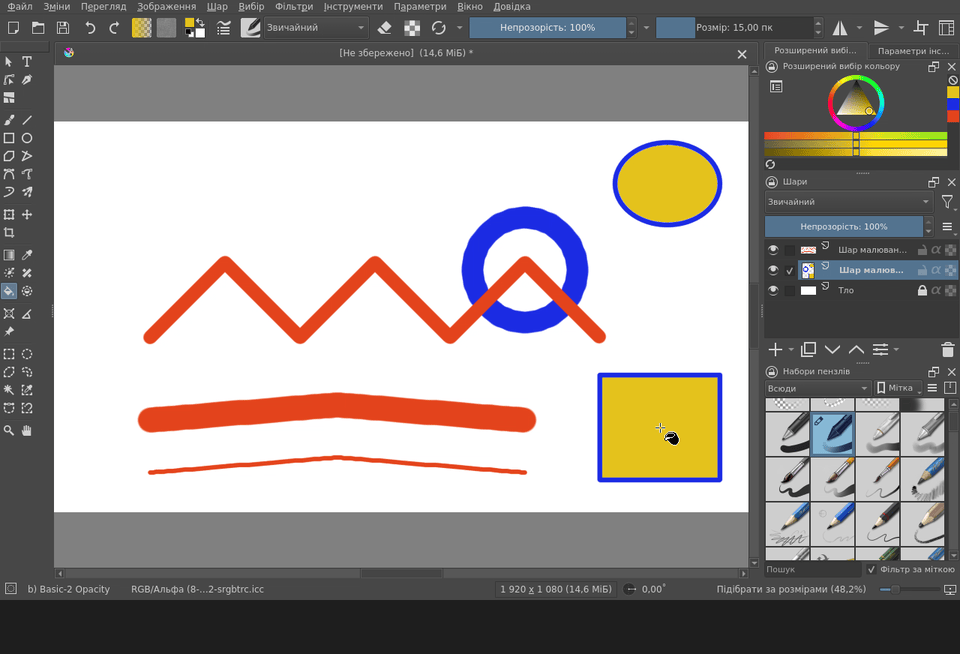

### 10. Відкриваємо фото

**Файл → Відкрити…**, оберіть файл фото й натисніть **Відкрити**. Фото відкриється в новій вкладці над полотном.

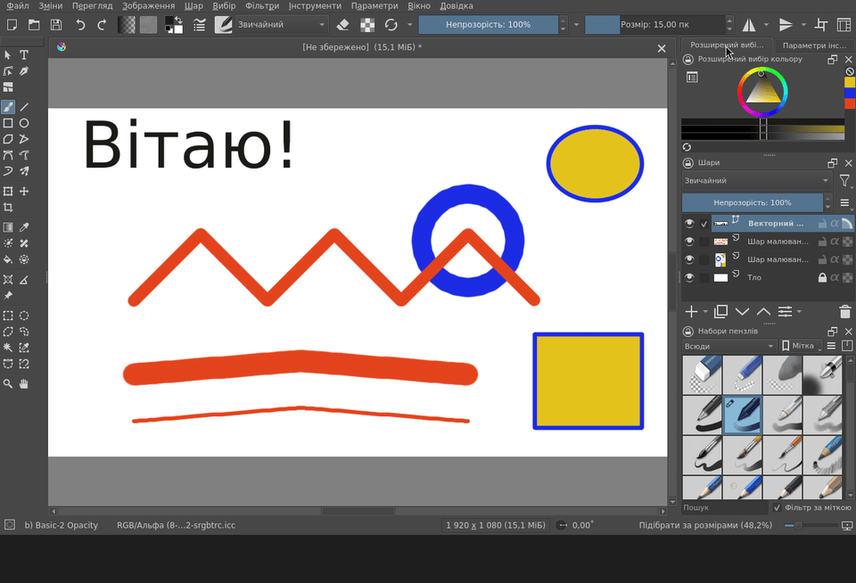

### 11. Кадрування (обрізання)

Інструмент **Кадрування**: протягніть рамку навколо потрібної частини фото й натисніть **Enter**. Усе поза рамкою буде обрізано.

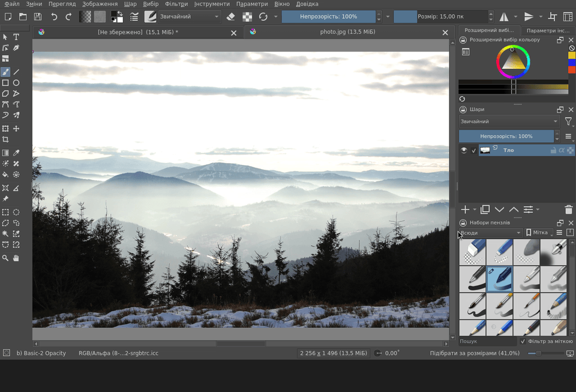

### 12. Розмір фото

**Зображення → Масштабувати зображення до нового розміру…** Введіть нову ширину. Якщо значок ланцюжка з’єднаний, висота зміниться сама і фото не сплющиться. Натисніть **Гаразд**.

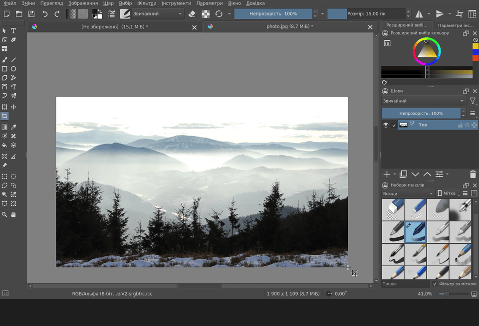

### 13. Яскравість

**Фільтри → Коригування → Коригування HSV/HSL** (або **Ctrl+U**). Якщо вікно закриває фото, перетягніть його за заголовок. Повзунок **Освітленість** праворуч робить фото світлішим. Натисніть **Гаразд**.

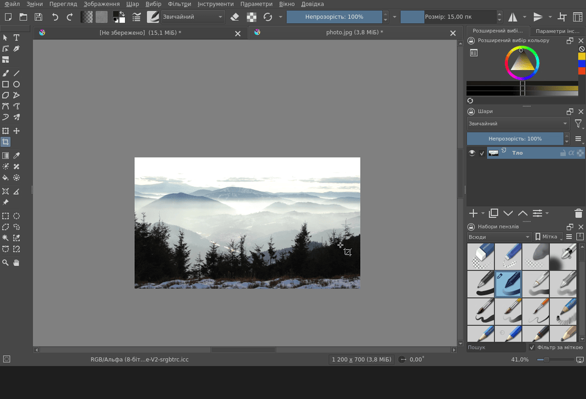

### 14. Експорт готової картинки

**Файл → Експортувати…** Оберіть теку, введіть назву з розширенням `.jpg` (або `.png`) і натисніть **Зберегти**. Для JPG програма запитає якість: що вона вища, то краща картинка, але важчий файл.

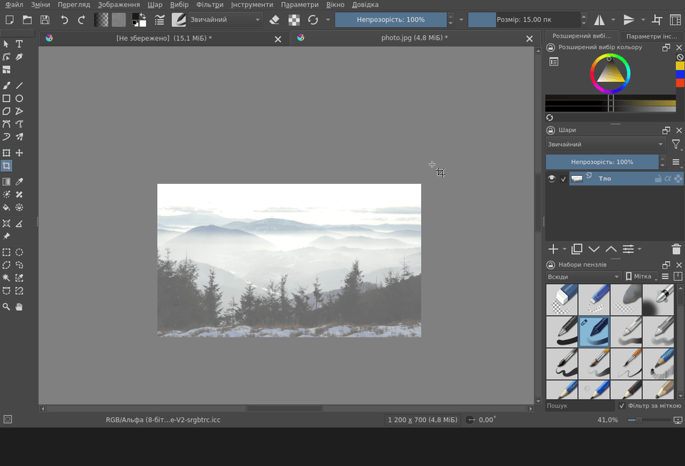

### 15. Збереження проєкту з шарами

**Файл → Зберегти як…**, назва з розширенням `.kra`. У такому файлі зберігаються всі шари, тож потім можна продовжити роботу.

## Підсумок

- Растрове зображення складається з пікселів; векторне — з ліній і фігур, які не втрачають якості при збільшенні.
- Шари дозволяють змінювати одну частину малюнка, не зачіпаючи інших.
- **Ctrl+Z** скасовує останню дію.
- JPG — для фото, PNG — для картинок із прозорістю й чіткими краями, KRA — робочий файл із шарами.
- Робочий проєкт **зберігають** у `.kra`, а готову картинку **експортують** у `.jpg` чи `.png`.

## Тест

10 запитань за матеріалом уроку (теорія та анімації на цій сторінці). На початку тесту вкажіть **прізвище, ім’я** та **групу**.

**[Пройти тест →](https://forms.gle/vdyZskWxerL8CF118)**

## Додаткове завдання

Необов’язково Виконуйте, якщо маєте бажання. Надіслану роботу буде оцінено.

Створіть у Krita **листівку**:

1. Нове полотно, фон залитий кольором.
2. Простий малюнок на **окремому шарі**.
3. Текст привітання.
4. Експорт у **PNG**.

Можна додати оброблене фото як ще один шар.

**Як надіслати:** листом на адресу **cpto.bakhmut.925@gmail.com** ([написати лист](mailto:cpto.bakhmut.925@gmail.com)). Файл додайте до листа як вкладення. У **темі листа** вкажіть прізвище, ім’я, групу і тему уроку, наприклад:

> Шевченко Оксана, група 21, Урок 1. Комп’ютерна графіка
