# Урок 1. Детальніше

<div class="how-to">

<span class="optional">Необов’язково</span> Ця сторінка для тих, кому цікаво дізнатися більше: як влаштована комп’ютерна графіка, з прикладами, діаграмами й посиланнями на джерела. **У тесті матеріалу цієї сторінки немає.**

[← Повернутися до уроку](index.md)

</div>

Усі приклади на цій сторінці зроблено з фото до уроку, а всі числа — справжні вимірювання.

## 1. Що зберігає піксель

Кожен піксель — це **три числа**: скільки в ньому червоного (**R**, Red), зеленого (**G**, Green) і синього (**B**, Blue) світла. Кожне число — від **0** (немає зовсім) до **255** (найбільше).

Ось справжні пікселі з фото до уроку — верхівка ялинки на тлі туману, збільшено:

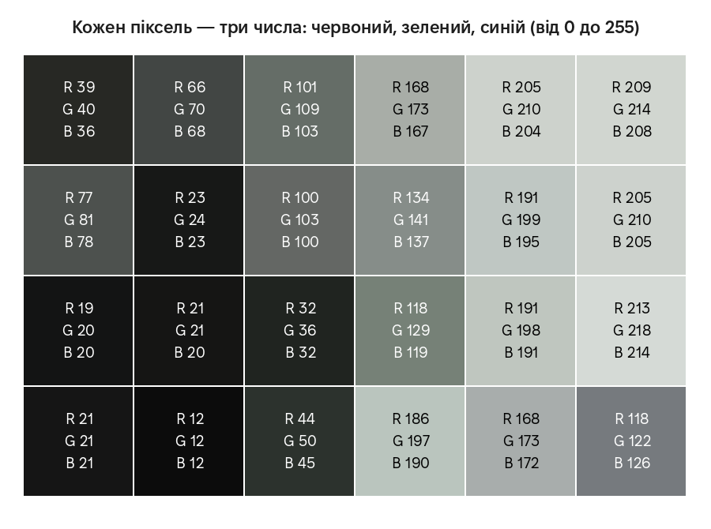

Темні пікселі ялинки мають малі числа (наприклад, 12, 12, 12), світлі пікселі туману — великі (213, 218, 214).

### Коди кольорів

Ті самі три числа часто записують коротко — **шістнадцятковим кодом** (HEX): знак `#` і по два символи на кожен канал. `FF` означає 255, `00` — 0. Такі коди використовують графічні програми (зокрема Krita) і вебсайти.

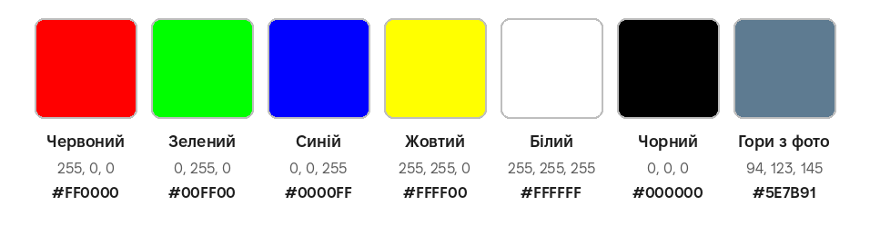

### Скільки всього кольорів

На кожен канал — 256 значень (від 0 до 255). Тож усього кольорів 256 × 256 × 256 = **16 777 216**. Це називають **8 біт на канал**.

Що більше відтінків, то плавніші переходи:

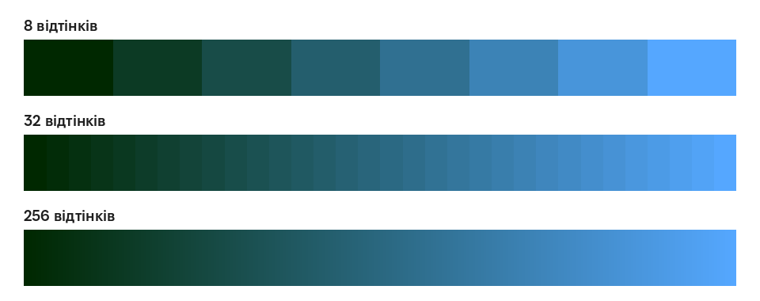

Для фото на екрані 8 біт на канал зазвичай досить. Krita вміє працювати і з 16 та 32 бітами на канал: це потрібно для складної обробки, коли переходи мають лишатися ідеально плавними.

**Джерела:**
[Krita: Моделі кольорів](https://docs.krita.org/uk_UA/general_concepts/colors/color_models.html) ·
[Krita: Бітова глибина](https://docs.krita.org/uk_UA/general_concepts/colors/bit_depth.html) ·
[Вікіпедія: Піксель](https://uk.wikipedia.org/wiki/Піксель) ·
[Вікіпедія: RGB](https://uk.wikipedia.org/wiki/RGB)

## 2. Екран і принтер: RGB і CMYK

**Екран світиться.** Він змішує світло трьох кольорів: червоного, зеленого й синього. Що більше світла додається, то світліше; усі три разом дають білий. Це **адитивне** (додавальне) змішування.

**Принтер друкує фарбою** на білому папері. Фарба поглинає частину світла, тому що більше фарб накладено одна на одну, то темніше. Основні фарби — блакитна (**C**, Cyan), пурпурова (**M**, Magenta) і жовта (**Y**, Yellow). Разом вони дають не чистий чорний, а брудно-темний колір, тому додають ще й чорну фарбу (**K**). Звідси назва **CMYK**.

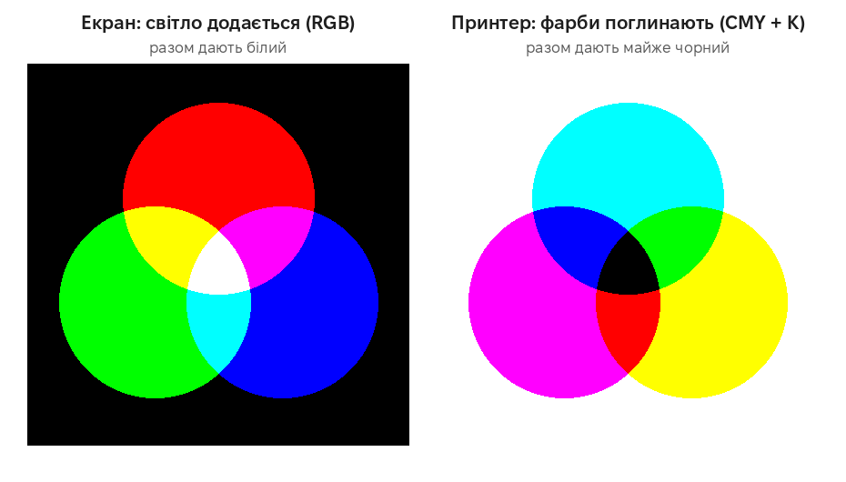

Що це означає на практиці:

- Деякі дуже яскраві кольори екрана (насичений зелений, синій) фарбами не відтворити, тому надрукований малюнок часто трохи тьмяніший, ніж на екрані.
- Для домашнього принтера чи фотосалону досить звичайного файлу JPG або PNG: перетворення в CMYK зробить сам принтер. Якщо друкуєте в друкарні, спитайте її вимоги до файлів.

**Джерела:**
[Вікіпедія: Адитивне змішання кольорів](https://uk.wikipedia.org/wiki/Адитивне_змішання_кольорів) ·
[Вікіпедія: CMYK](https://uk.wikipedia.org/wiki/CMYK) ·
[Krita: Моделі кольорів](https://docs.krita.org/uk_UA/general_concepts/colors/color_models.html)

## 3. Роздільна здатність і друк

На екрані важлива лише **кількість пікселів**. А на папері — ще й те, скільки пікселів припадає на один дюйм (2,54 см). Це **роздільна здатність друку**, її позначають **dpi** або **ppi** (точок чи пікселів на дюйм).

Розмір відбитка легко порахувати:

> **розмір у сантиметрах = пікселі ÷ dpi × 2,54**

Ось одне й те саме зображення 1200 × 800 пікселів, надруковане з різною роздільністю (намальовано в масштабі):

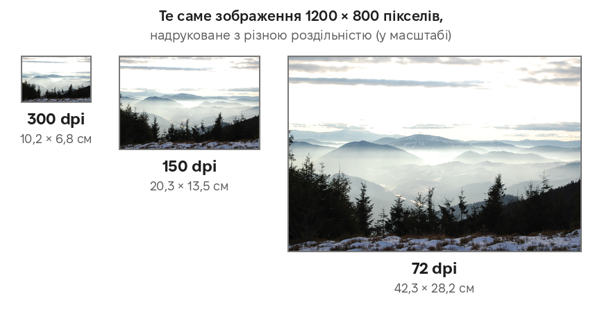

Пікселів у всіх трьох випадках однаково. Що менше dpi, то більший відбиток, але й кожен піксель на папері більший — зблизька стають видно «квадратики». Для фото й документів, на які дивляться з відстані руки, беруть близько **300 dpi**. Плакат, на який дивляться здалеку, можна друкувати з меншою роздільністю.

Скільки пікселів потрібно для друку з 300 dpi:

| Що друкуємо | Розмір | Потрібно пікселів |
|---|---|---|
| Фото | 10 × 15 см | 1181 × 1772 |
| Аркуш A4 | 21 × 29,7 см | 2480 × 3508 |
| Аркуш A3 | 29,7 × 42 см | 3508 × 4961 |

Розмір 2480 × 3508 ви вже бачили: саме його Krita пропонує для нового полотна — це аркуш A4 з 300 dpi.

**Приклад.** Фото з телефона 4000 × 3000 пікселів можна якісно надрукувати розміром до 4000 ÷ 300 × 2,54 ≈ **33,9 см** на 3000 ÷ 300 × 2,54 = **25,4 см**.

**Джерела:**
[Вікіпедія: Dots per inch](https://uk.wikipedia.org/wiki/Dots_per_inch) ·
[Вікіпедія: Щільність пікселів](https://uk.wikipedia.org/wiki/Щільність_пікселів)

## 4. Скільки важить зображення і що таке стиснення

Без стиснення кожен піксель займає **3 байти** — по одному на R, G і B. Тоді зображення 1200 × 800 займало б:

> 1200 × 800 × 3 = 2 880 000 байтів ≈ **2,7 МБ**

Щоб файли були меншими, їх **стискають**. Є два способи:

- **Без втрат** (PNG). Дані записуються компактніше, але після відкриття зображення точно таке саме, до останнього пікселя.
- **З втратами** (JPG). Програма відкидає дрібні деталі, які око майже не помічає. Файл набагато менший, але відкинуті деталі втрачено назавжди.

### Якість JPG

Під час експорту в JPG Krita питає «Якість» (типово 80 %). Ось та сама ділянка фото, збережена з різною якістю (збільшено в 3 рази):

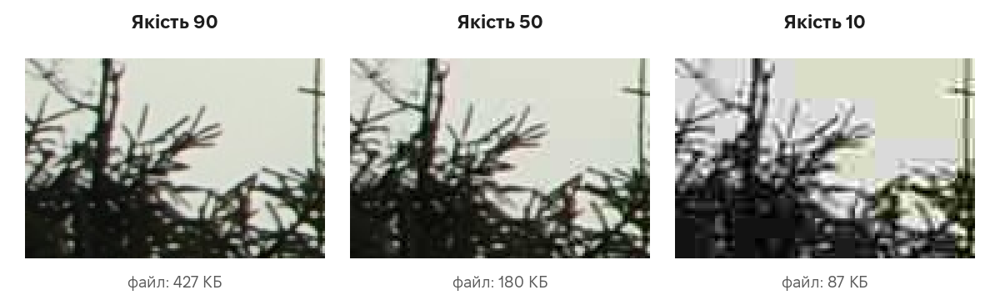

З якістю 90 і 50 різницю майже не видно. З якістю 10 з’являються помітні квадрати: JPG стискає зображення невеликими блоками 8 × 8 пікселів, і при сильному стисненні їх стає видно.

А так змінюється розмір файлу фото до уроку (2256 × 1496 пікселів):

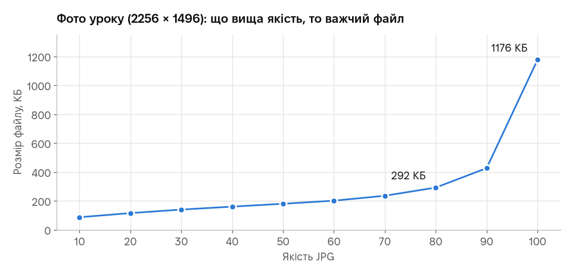

| Якість | Розмір файлу |
|---|---|
| 10 | 87 КБ |
| 20 | 116 КБ |
| 30 | 140 КБ |
| 40 | 161 КБ |
| 50 | 180 КБ |
| 60 | 202 КБ |
| 70 | 236 КБ |
| 80 | 292 КБ |
| 90 | 427 КБ |
| 100 | 1176 КБ |

Від якості 80 до 100 файл важчає **в 4 рази** (з 292 до 1176 КБ), а різниці на око майже немає. Тому якість **80–90** — розумний вибір для більшості фото.

### Чи псується JPG від повторного збереження?

Якщо просто відкрити JPG і знову зберегти з тією самою якістю, втрати мінімальні: ми перевірили — після 50 таких збережень фото майже не змінилося. Але якщо між збереженнями **редагувати** фото або **змінювати якість**, втрати накопичуються щоразу.

Тому правило просте: **працюйте у `.kra` (або PNG), а в JPG експортуйте один раз — наприкінці.**

**Джерела:**
[Krita: Стискання зображень із втратами і без втрат](https://docs.krita.org/uk_UA/general_concepts/file_formats/lossy_lossless.html) ·
[Krita: *.jpg](https://docs.krita.org/uk_UA/general_concepts/file_formats/file_jpeg.html) ·
[Вікіпедія: Стиснення з втратами](https://uk.wikipedia.org/wiki/Стиснення_з_втратами) ·
[Вікіпедія: JPEG](https://uk.wikipedia.org/wiki/JPEG) ·
[JPEG Committee (англ.)](https://jpeg.org/jpeg/)

## 5. Який формат обрати

Ми зберегли два зображення однакового розміру (1200 × 800) — фото і простий малюнок з однотонними ділянками — у трьох форматах:

<div class="pair">
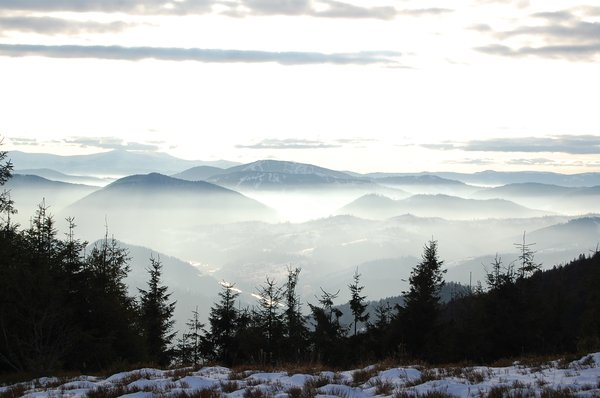
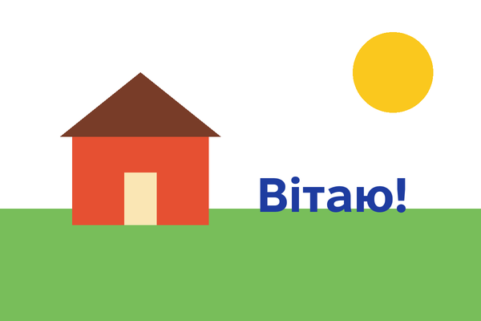
</div>

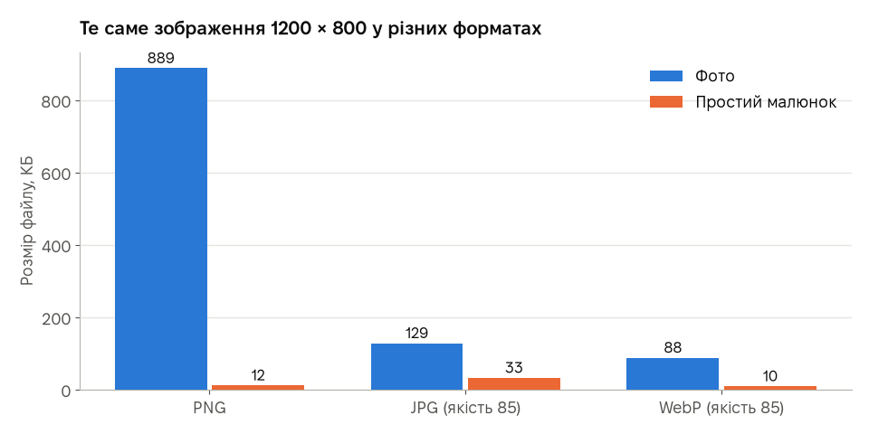

| Формат | Фото | Простий малюнок |
|---|---|---|
| Без стиснення | 2812 КБ | 2812 КБ |
| PNG | 889 КБ | 12 КБ |
| JPG (якість 85) | 129 КБ | 33 КБ |
| WebP (якість 85) | 88 КБ | 10 КБ |

Що видно з порівняння:

- Для **фото** PNG дуже важкий (889 КБ), а JPG майже **в 7 разів** легший (129 КБ).
- Для **малюнка з однотонними ділянками** найкращий PNG: 12 КБ і жодних втрат. JPG тут важчий (33 КБ) і ще й псує краї — навколо літер з’являється «бруд»:

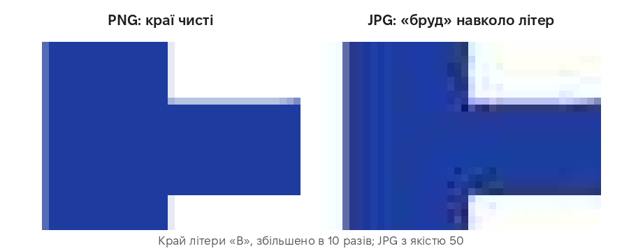

- **WebP** найменший в обох випадках. Його підтримують усі сучасні браузери, і Krita теж уміє в нього зберігати. Але деякі старіші програми WebP ще не відкривають.

**Шпаргалка**

| Формат | Стиснення | Прозорість | Анімація | Для чого |
|---|---|---|---|---|
| **JPG** | з втратами | ні | ні | фото |
| **PNG** | без втрат | так | рідко | малюнки, скриншоти, логотипи, усе з текстом |
| **GIF** | без втрат, але лише 256 кольорів | так, але без напівпрозорості | так | прості анімації |
| **WebP** | з втратами або без | так | так | зображення на сайтах |
| **SVG** | вектор | так | так | логотипи, значки, схеми |
| **KRA** | без втрат, зберігає шари | так | так | робочий файл Krita |

**Джерела:**
[Krita: Формати файлів](https://docs.krita.org/uk_UA/general_concepts/file_formats.html) ·
[Krita: *.png](https://docs.krita.org/uk_UA/general_concepts/file_formats/file_png.html) ·
[Krita: *.webp](https://docs.krita.org/uk_UA/general_concepts/file_formats/file_webp.html) ·
[Krita: *.gif](https://docs.krita.org/uk_UA/general_concepts/file_formats/file_gif.html) ·
[Krita: *.kra](https://docs.krita.org/uk_UA/general_concepts/file_formats/file_kra.html) ·
[MDN: Image file type and format guide (англ.)](https://developer.mozilla.org/en-US/docs/Web/Media/Guides/Formats/Image_types) ·
[Google: WebP (англ.)](https://developers.google.com/speed/webp) ·
[W3C: специфікація PNG (англ.)](https://www.w3.org/TR/png-3/)

## 6. Векторна графіка і формат SVG

Векторний файл зберігає не пікселі, а **опис фігур**: «коло з центром тут, такого радіуса, жовтого кольору». Ось увесь файл SVG — це звичайний текст:

```xml
<svg xmlns="http://www.w3.org/2000/svg" viewBox="0 0 200 200">
  <rect width="200" height="200" fill="#bfe3ff"/>
  <circle cx="100" cy="100" r="45" fill="#f5c400"/>
  <g stroke="#f5c400" stroke-width="8" stroke-linecap="round">
    <line x1="100" y1="15" x2="100" y2="40"/>
    <line x1="100" y1="160" x2="100" y2="185"/>
    <line x1="15" y1="100" x2="40" y2="100"/>
    <line x1="160" y1="100" x2="185" y2="100"/>
  </g>
</svg>
```

А ось що з нього малює браузер — той самий файл у двох розмірах:

<div class="pair">
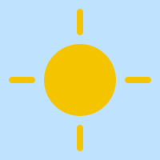

</div>

Обидва однаково чіткі, бо програма щоразу малює фігури наново. Помітили коди кольорів `#f5c400`? Це ті самі HEX-коди з розділу 1. Увесь файл важить лише **430 байтів**.

Коли що обирати:

- **вектор** — логотипи, значки, схеми, шрифти: усе, що складається з чітких фігур і має добре виглядати в будь-якому розмірі;
- **растр** — фото й малюнки з плавними переходами та текстурами.

Для векторної графіки є окремі програми. Безкоштовна і з відкритим кодом — **Inkscape**. У Krita вектор теж є: текст у ній створюється на векторному шарі, як напис «Вітаю!» в уроці.

**Джерела:**
[Krita: *.svg](https://docs.krita.org/uk_UA/general_concepts/file_formats/file_svg.html) ·
[Вікіпедія: Векторна графіка](https://uk.wikipedia.org/wiki/Векторна_графіка) ·
[Вікіпедія: Scalable Vector Graphics](https://uk.wikipedia.org/wiki/Scalable_Vector_Graphics) ·
[Inkscape](https://inkscape.org/uk/) ·
[W3C: специфікація SVG 2 (англ.)](https://www.w3.org/TR/SVG2/)

## 7. Графічний планшет

Художники часто малюють не мишею, а **графічним планшетом** — пластиною зі спеціальним пером. Є планшети без екрана (дивитеся на монітор, а малюєте на пластині) і з екраном (малюєте просто по зображенню).

Головна перевага пера — воно відчуває **силу натиску** (тисячі рівнів). Krita може зв’язати натиск із товщиною чи прозорістю лінії, і лінія поводиться як справжній олівець чи пензель:

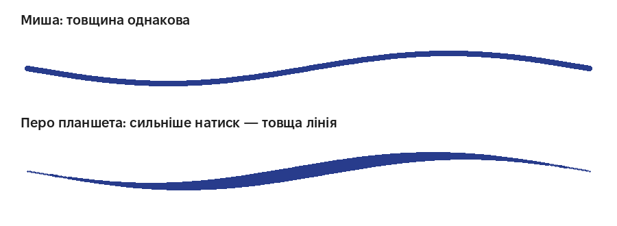

Деякі пера відчувають ще й нахил, а на інших є кнопки, на які можна призначити, наприклад, гумку чи піпетку. Krita має окремі налаштування для планшетів — про них у посібнику нижче.

**Джерела:**
[Krita: Планшети для малювання](https://docs.krita.org/uk_UA/user_manual/drawing_tablets.html) ·
[Вікіпедія: Графічний планшет](https://uk.wikipedia.org/wiki/Графічний_планшет)

## 8. Де брати зображення законно

Не кожну картинку з інтернету можна вільно використовувати: більшість захищена авторським правом. Шукайте зображення з **вільними ліцензіями**. Найпоширеніші — ліцензії **Creative Commons** (CC):

| Позначка | Що можна | Умова |
|---|---|---|
| **Суспільне надбання**, **CC0** | використовувати як завгодно | немає |
| **CC BY** | використовувати й змінювати, навіть для заробітку | вказати автора |
| **CC BY-SA** | те саме | вказати автора і поширювати свою роботу на тих самих умовах |
| **CC BY-NC** | використовувати й змінювати | вказати автора; лише некомерційно |

**Приклад.** Фото до уроку ми взяли з **Wikimedia Commons** — це сховище з мільйонами вільних зображень. На сторінці кожного файлу вказано автора й ліцензію. Наше фото — у суспільному надбанні, тож автора можна не вказувати, але ми все одно його вказали: це гарний тон.

**Джерела:**
[Creative Commons: Про ліцензії](https://creativecommons.org/licenses/?lang=uk) ·
[CC BY 4.0 (укр.)](https://creativecommons.org/licenses/by/4.0/deed.uk) ·
[CC0 (укр.)](https://creativecommons.org/publicdomain/zero/1.0/deed.uk) ·
[Вікіпедія: Creative Commons](https://uk.wikipedia.org/wiki/Creative_Commons) ·
[Wikimedia Commons: фото до уроку](https://commons.wikimedia.org/wiki/File:Carpathians_in_Ukraine.JPG)

---

[← Повернутися до уроку](index.md)
