# Урок 2. Текстові документи

**Як працювати з уроком**

1. Прочитайте теорію. Сторінку «Детальніше» відкривайте, якщо цікаво.
2. Перегляньте анімації: кожна показує одну дію крок за кроком.
3. Пройдіть [тест](#тест) (10 запитань). На початку вкажіть прізвище, ім’я та групу.
4. За бажанням виконайте [додаткове завдання](#додаткове-завдання). Воно необов’язкове, але якщо ви його надішлете, воно буде оцінене.

## Мета уроку

Ви навчитеся в програмі **LibreOffice Writer** оформлювати охайний документ — на прикладі **резюме**:

- змінювати шрифт, розмір, жирність і вирівнювання тексту;
- робити заголовки стилями, списки й таблиці;
- вставляти фото;
- зберігати документ і надсилати його у форматі PDF.

## Що знадобиться

- Програма **LibreOffice**: безкоштовна, з відкритим кодом. Завантажити можна з офіційного сайту **libreoffice.org** (розділ «Завантажити»). Writer — її частина для текстів.
- Файли для вправ:
  - [text.txt](files/text.txt) — текст резюме, щоб не набирати вручну;
  - [photo.jpg](files/photo.jpg) — фото-заглушка (силует);
  - [zrazok-rezyume.pdf](files/zrazok-rezyume.pdf) — що має вийти в кінці.

> На анімаціях людина з резюме вигадана, а контакти — несправжні.

## Теорія

**Абзац** — це текст від одного натискання **Enter** до наступного. Довгий абзац сам переноситься на нові рядки, тому Enter натискають лише наприкінці абзацу. Кінець абзацу Writer позначає невидимим знаком **¶** (показати ці знаки: **Ctrl+F10**).

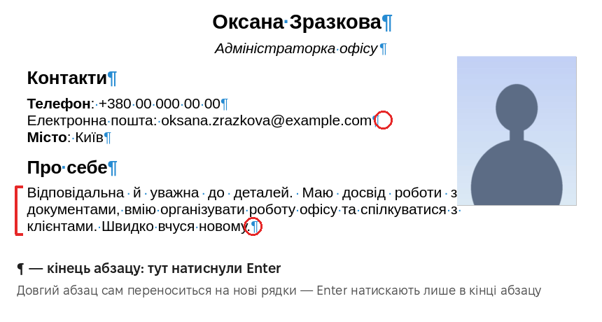

**Стилі.** Заголовки краще робити не «жирним і більшим шрифтом» вручну, а **стилем** «Заголовок 1», «Заголовок 2». Тоді:

- усі заголовки виглядають однаково;
- Writer «розуміє» план документа і показує його в **Навігаторі**;
- з заголовків можна автоматично зробити зміст.

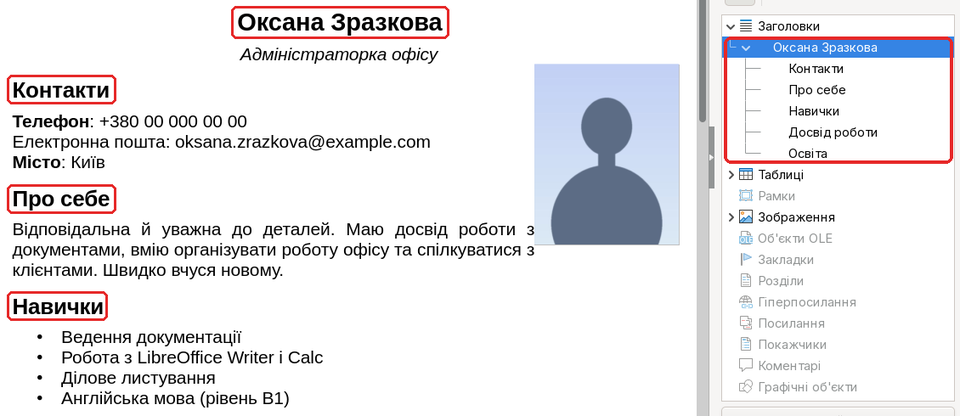

**Формати файлів**

| Формат | Що це | Коли використовувати |
|---|---|---|
| **ODT** | основний формат LibreOffice | щоб далі редагувати в LibreOffice |
| **DOCX** | формат Microsoft Word | якщо документ редагуватиме людина з Word |
| **PDF** | «знімок» документа для читання й друку | щоб **надіслати**: виглядає однаково на будь-якому пристрої |

**Гарячі клавіші** — працюють і в інших програмах:

| Клавіші | Дія | Клавіші | Дія |
|---|---|---|---|
| **Ctrl+C** | копіювати | **Ctrl+B** | жирний |
| **Ctrl+V** | вставити | **Ctrl+I** | курсив |
| **Ctrl+X** | вирізати | **Ctrl+U** | підкреслений |
| **Ctrl+Z** | скасувати дію | **Ctrl+A** | виділити все |
| **Ctrl+S** | зберегти | **Ctrl+P** | друкувати |

**Хочете знати більше?** Необов’язково

На сторінці [**Детальніше**](more.md) — з прикладами, діаграмами й посиланнями на джерела:

- чим текстовий редактор відрізняється від текстового процесора;
- що насправді всередині файлу .odt і чому формати важать по-різному;
- Enter і Shift+Enter;
- шрифти із зарубками й без, розміри в пунктах;
- поля й орієнтація сторінки;
- автоматичний зміст;
- сумісність LibreOffice і Microsoft Office;
- ще більше гарячих клавіш.

У тесті цього матеріалу немає.

## Покроково

### 1. Вікно програми

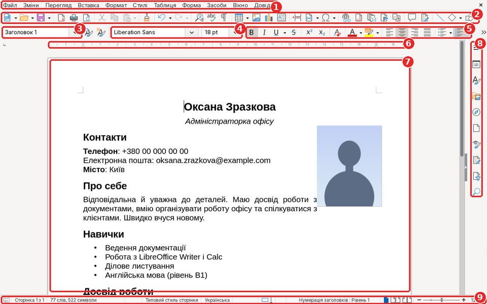

1. **Меню**: усі команди програми.
2. **Стандартна панель**: створити, відкрити, зберегти, експорт у PDF, друк, скасувати.
3. **Стиль абзацу**: «Заголовок 1», «Заголовок 2», «Типовий стиль абзацу».
4. **Шрифт і розмір**.
5. **Форматування**: жирний, курсив, підкреслений, колір, вирівнювання, списки.
6. **Лінійка**: поля й відступи.
7. **Сторінка**: тут ви пишете.
8. **Бічна панель**: властивості, стилі, Навігатор.
9. **Рядок стану**: номер сторінки, кількість слів, мова, масштаб.

### 2. Вставляємо й виділяємо текст

Скопіюйте текст із файлу **text.txt** і вставте у Writer: **Ctrl+V**. Щоб виділити:

- одне слово — **подвійне клацання**;
- кілька рядків — **протягніть мишею** з натиснутою кнопкою;
- увесь текст — **Ctrl+A**.

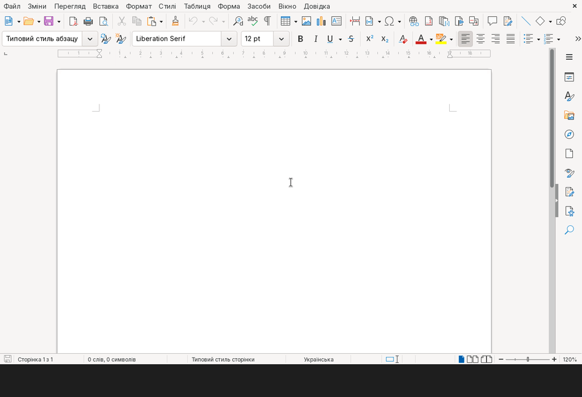

### 3. Шрифт, розмір, жирний, курсив

Виділіть текст і оберіть **шрифт** та **розмір** у списках на панелі. Кнопки **B** (жирний) та **I** (курсив) змінюють виділений текст. Те саме клавішами: **Ctrl+B**, **Ctrl+I**, **Ctrl+U** (підкреслений).

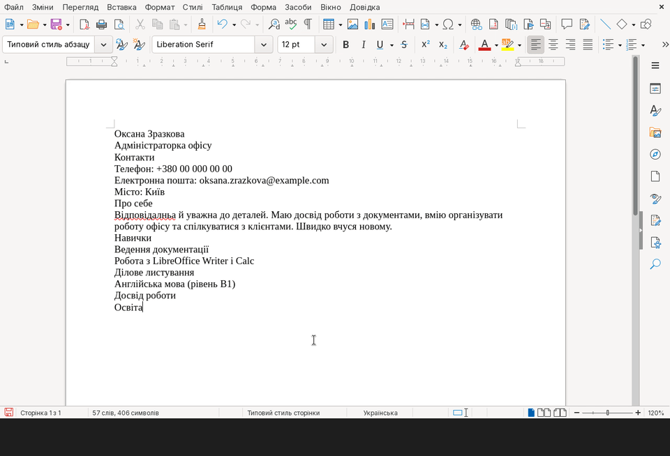

### 4. Стилі заголовків

Клацніть у рядку з іменем і оберіть у списку стиль **Заголовок 1**. Назви розділів зробіть стилем **Заголовок 2** — швидко це робить **Ctrl+2**. **Навігатор** у бічній панелі (**Alt+4**) показує план документа; подвійне клацання в ньому переносить до потрібного розділу.

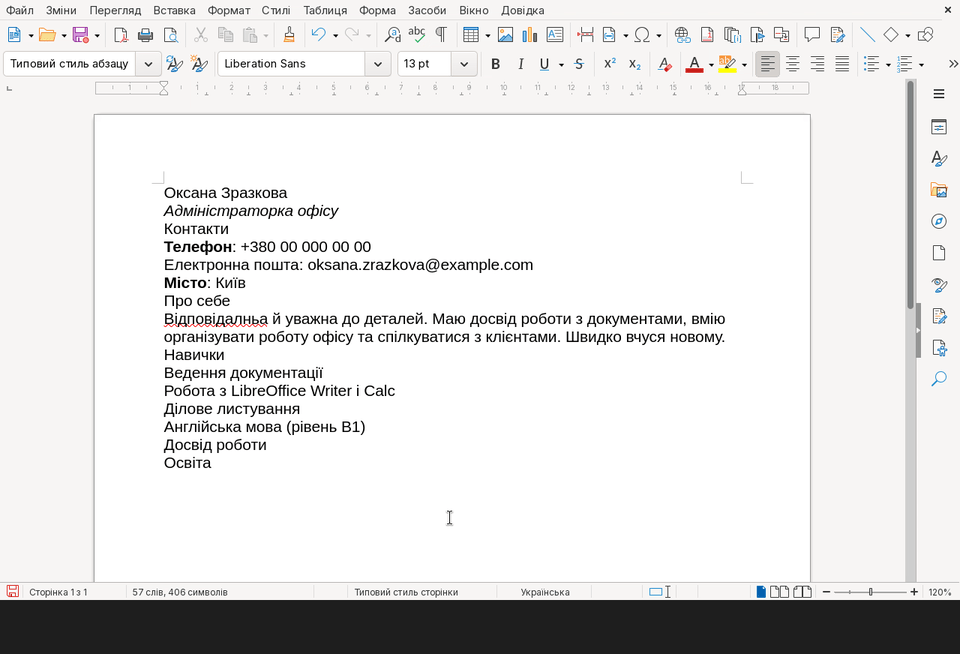

### 5. Вирівнювання абзаців

Клацніть в абзаці й оберіть кнопку вирівнювання: **ліворуч**, **по центру**, **праворуч** або **за шириною** (рівні краї з обох боків). Вирівнювання діє на весь абзац, виділяти його не треба.

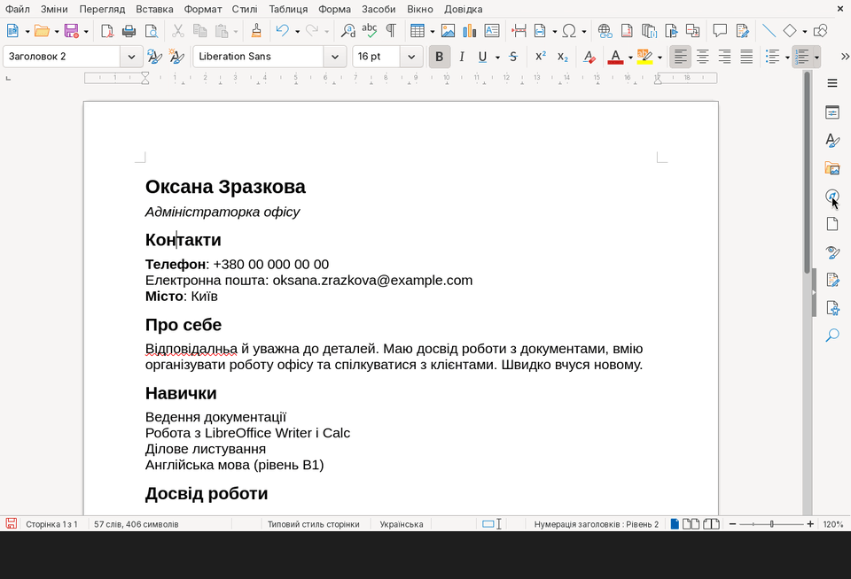

### 6. Списки

Виділіть рядки й натисніть **Маркований список** (крапки) або **Нумерований список** (1, 2, 3…). Нумерований — коли важливий порядок, наприклад кроки інструкції.

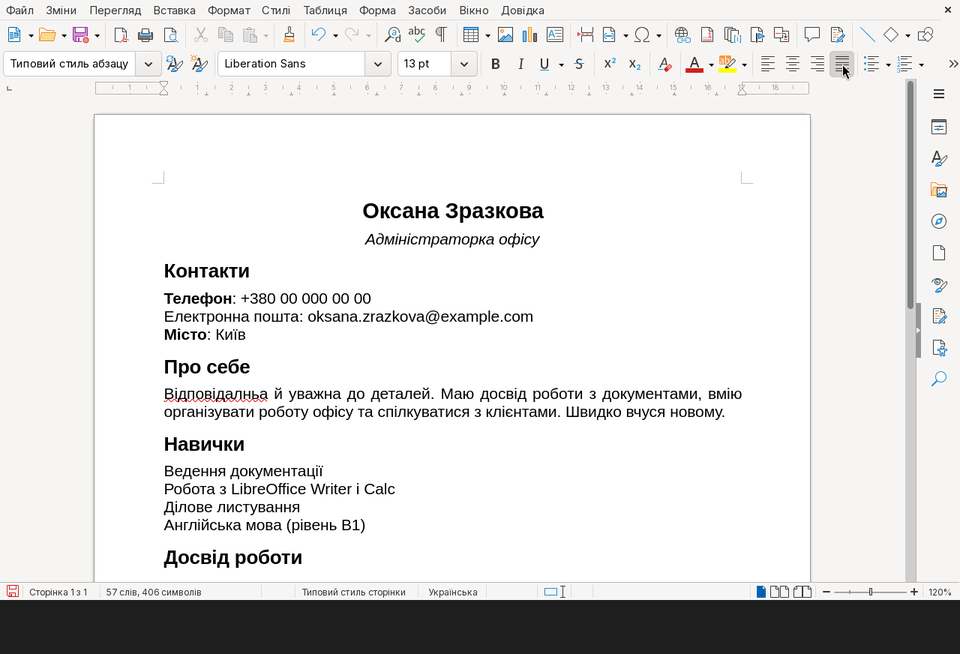

### 7. Фото

**Вставка → Зображення…**, оберіть файл і натисніть **Відкрити**. Перетягніть фото мишею на потрібне місце — текст обтікатиме його. Щоб змінити розмір без спотворення, тягніть за **кутовий** маркер.

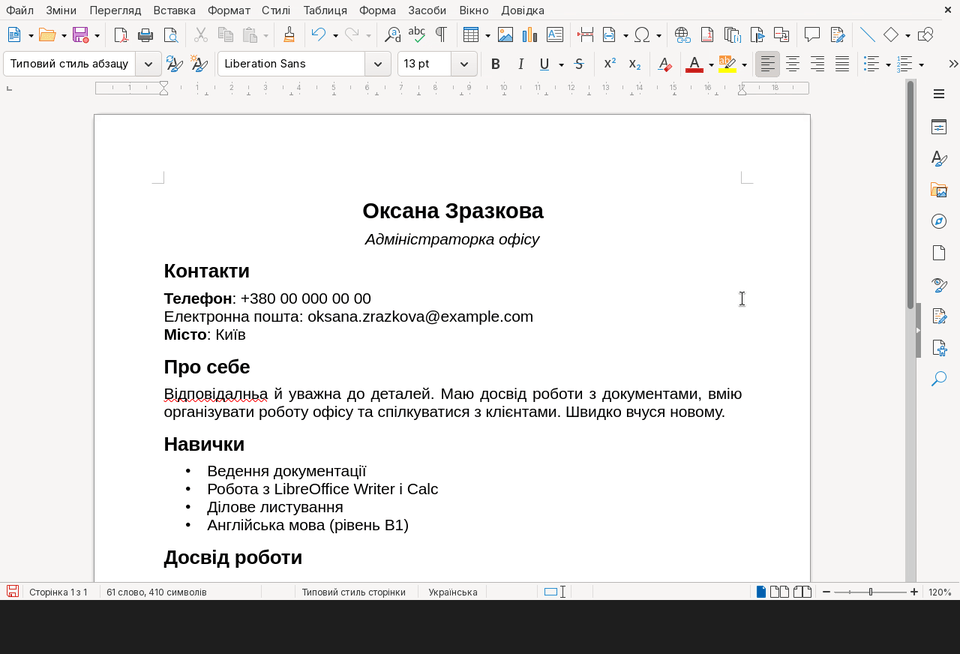

### 8. Таблиця

**Таблиця → Вставити таблицю…**, вкажіть кількість стовпчиків і рядків, натисніть **Вставити**. Клавіша **Tab** переносить до наступної клітинки, а в останній клітинці — додає новий рядок.

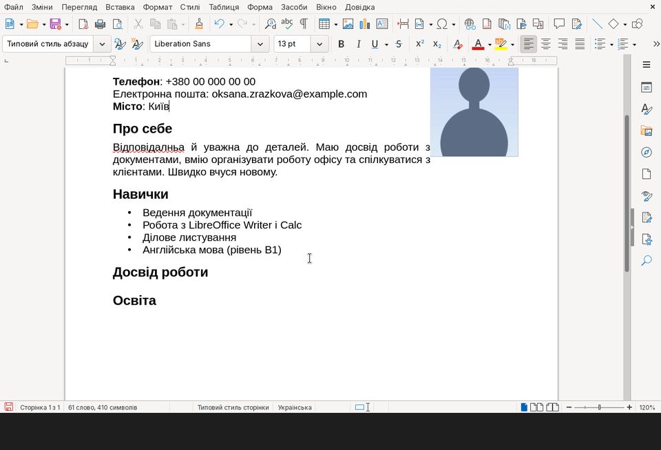

### 9. Перевірка правопису

Червона хвиляста лінія під словом означає можливу помилку. Клацніть по слову **правою кнопкою** миші й оберіть правильний варіант угорі списку.

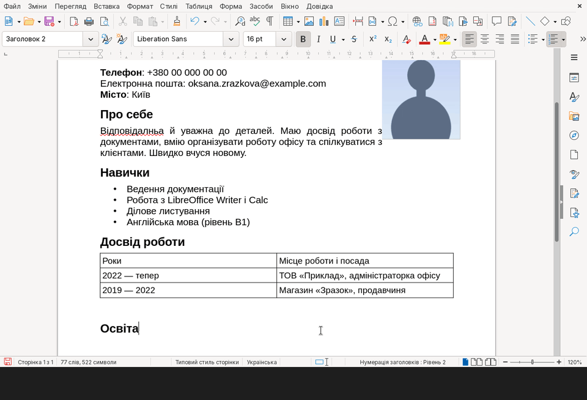

### 10. Збереження: ODT і DOCX

**Файл → Зберегти як…**, введіть назву, натисніть **Зберегти** — документ збережеться у форматі **ODT**. Щоб надіслати файл людині з Word, збережіть ще й копію: тип файлу **Документ Word (.docx)** і підтвердіть **Використати формат Документ Word**.

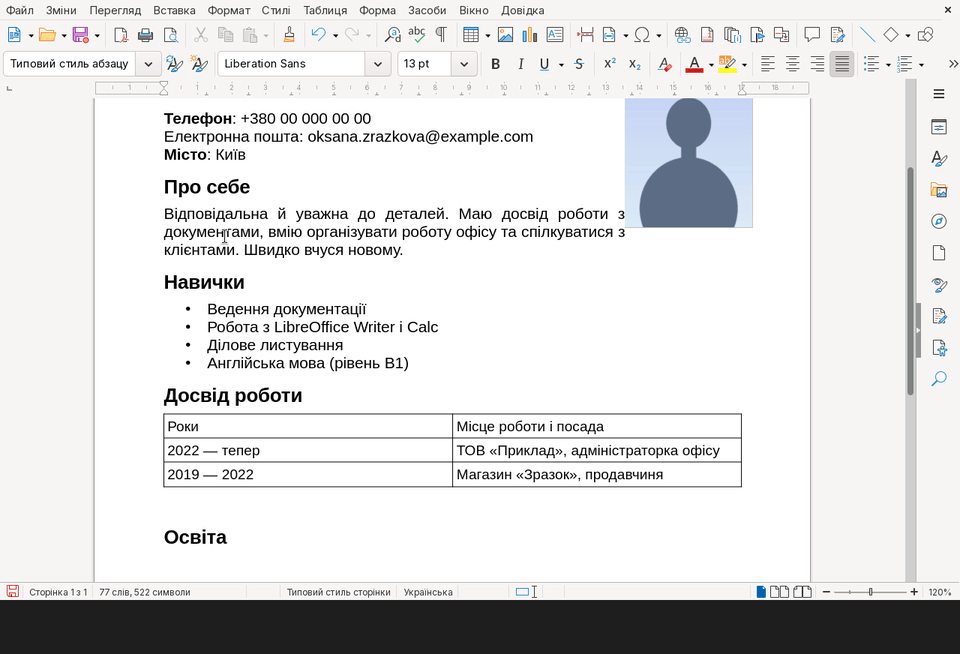

### 11. Експорт у PDF

Кнопка **Експортувати безпосередньо як PDF** на панелі, далі **Експорт**. Саме PDF надсилайте роботодавцю чи в установу: його відкриє будь-який телефон чи комп’ютер, і він виглядатиме так само, як у вас.

Ось що вийшло:

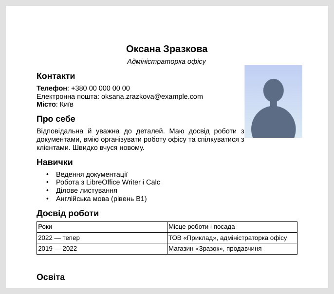

## Підсумок

- Абзац закінчується натисканням **Enter**; довгий текст переноситься на нові рядки сам.
- Заголовки робіть **стилями** — так документ має план, і заголовки однакові.
- Списки, таблиці й фото роблять документ зрозумілим з першого погляду.
- **ODT** — для роботи в LibreOffice, **DOCX** — для Word, **PDF** — щоб надіслати.
- **Ctrl+C**, **Ctrl+V**, **Ctrl+Z**, **Ctrl+S** працюють майже в усіх програмах.

## Тест

10 запитань за матеріалом уроку (теорія та анімації на цій сторінці). На початку тесту вкажіть **прізвище, ім’я** та **групу**.

**[Пройти тест →](https://forms.gle/kYD2HWuUmeF2L41A9)**

## Додаткове завдання

Необов’язково Виконуйте, якщо маєте бажання. Надіслану роботу буде оцінено.

Зробіть **власне резюме** (або резюме вигаданої людини):

1. Ім’я — стилем **Заголовок 1**, розділи — **Заголовок 2**.
2. Список навичок.
3. Таблиця з освітою або досвідом роботи.
4. Фото (можна будь-яке зображення-заглушку).
5. Експорт у **PDF**.

Не вказуйте справжні номер телефону й адресу, якщо надсилаєте роботу викладачеві.

**Як надіслати:** листом на адресу **cpto.bakhmut.925@gmail.com** ([написати лист](mailto:cpto.bakhmut.925@gmail.com)). Файл додайте до листа як вкладення. У **темі листа** вкажіть прізвище, ім’я, групу і тему уроку, наприклад:

> Шевченко Оксана, група 21, Урок 2. Текстові документи
