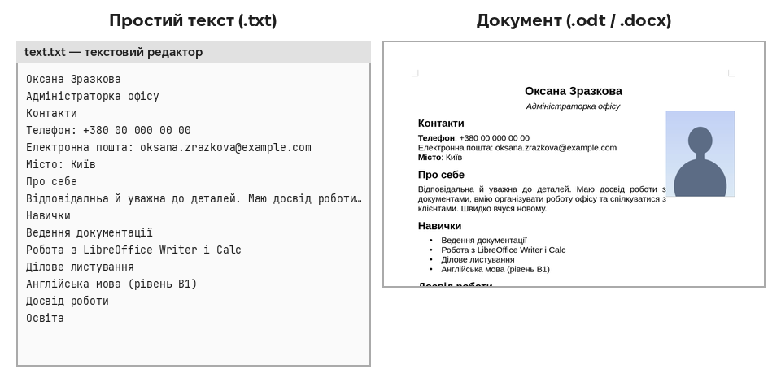
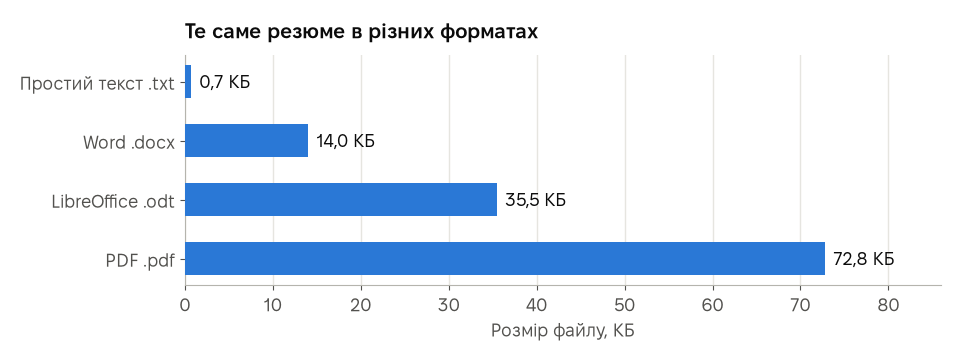
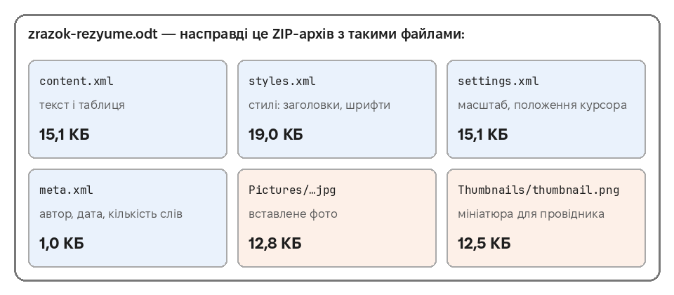
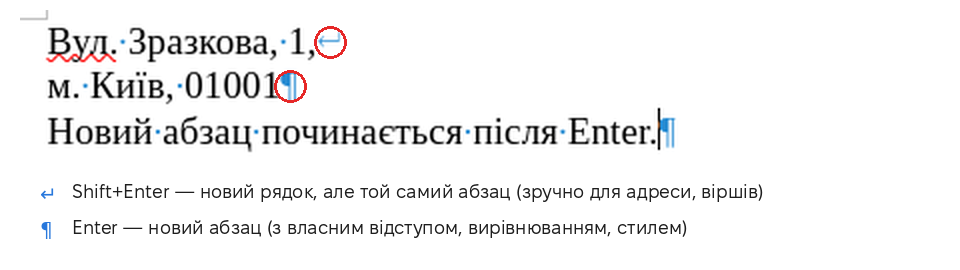
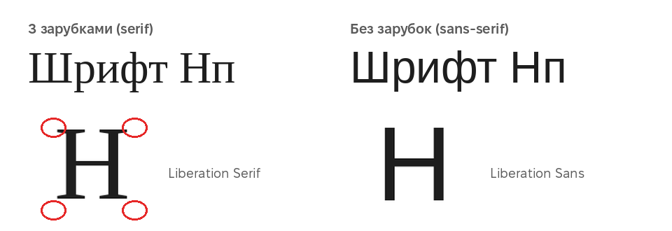
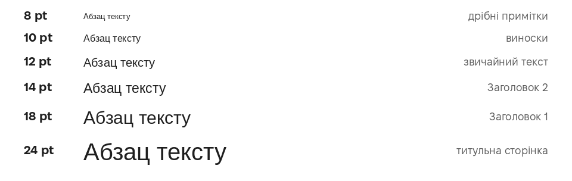
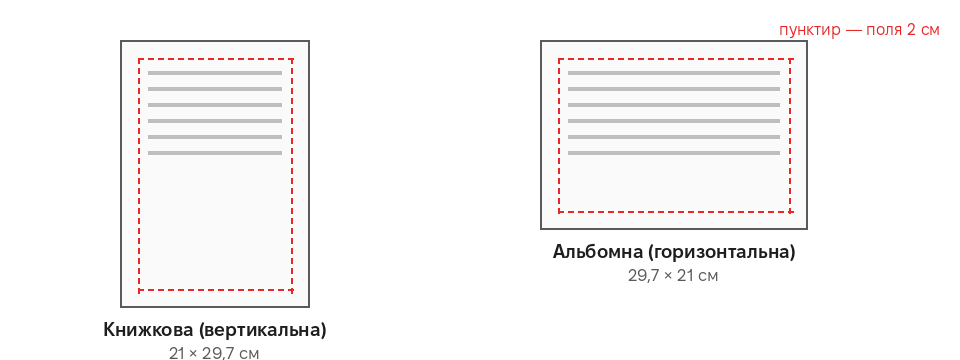
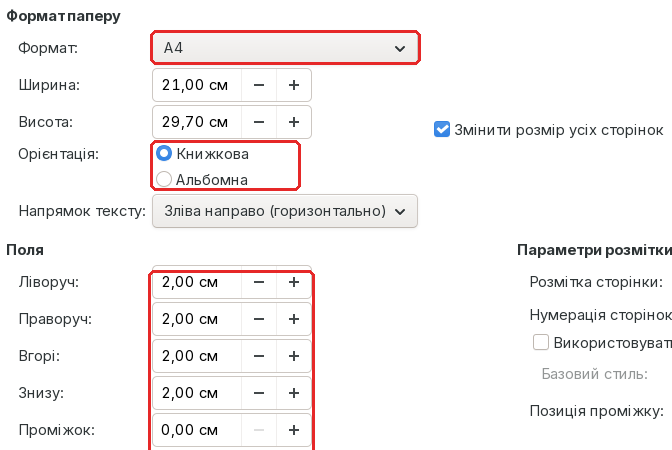
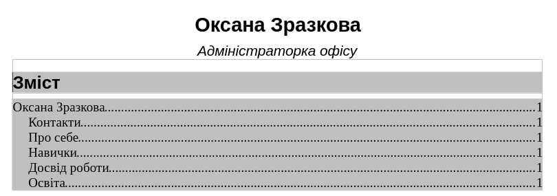

# Урок 2. Детальніше

Необов’язково Ця сторінка для тих, кому цікаво дізнатися більше про текстові документи: з прикладами, діаграмами й посиланнями на джерела. **У тесті матеріалу цієї сторінки немає.**

[← Повернутися до уроку](index.md)

Усі приклади зроблено з того самого резюме, що й в уроці, а всі числа — справжні вимірювання.

## 1. Текстовий редактор чи текстовий процесор

**Текстовий редактор** (Блокнот у Windows, gedit, Kate) зберігає лише **літери** — без шрифтів, жирності, таблиць і картинок. Такий файл має розширення `.txt` і відкривається будь-де.

**Текстовий процесор** (LibreOffice Writer, Microsoft Word) зберігає ще й **оформлення**: шрифти, стилі, списки, таблиці, фото, поля сторінки.

Текст ліворуч і праворуч однаковий — це той самий файл `text.txt` з уроку. Відрізняється лише оформлення.

Простий текст теж корисний: у ньому пишуть програми (урок 4), налаштування, нотатки. А ще він зручний, щоб **перенести текст без зайвого форматування**: у Writer є команда «Вставити як неформатований текст» (**Ctrl+Alt+Shift+V**).

**Джерела:**
[Вікіпедія: Текстовий редактор](https://uk.wikipedia.org/wiki/Текстовий_редактор) ·
[Вікіпедія: Текстовий процесор](https://uk.wikipedia.org/wiki/Текстовий_процесор) ·
[Довідка LibreOffice Writer](https://help.libreoffice.org/latest/uk/text/swriter/main0000.html)

## 2. Що всередині файлу документа

Ми зберегли те саме резюме в різних форматах і порівняли розміри:

| Формат | Розмір | Що в ньому |
|---|---|---|
| Простий текст `.txt` | 0,7 КБ | лише літери (без фото й оформлення) |
| Word `.docx` | 14,0 КБ | текст, стилі, фото |
| LibreOffice `.odt` | 35,5 КБ | текст, стилі, фото **і мініатюра** |
| PDF `.pdf` | 72,8 КБ | готові сторінки **разом зі шрифтами** |

Чому так?

- Файли **ODT і DOCX — це насправді ZIP-архіви**. Усередині — кілька файлів: текст, стилі, налаштування, фото. Ось що знайшлося всередині нашого `.odt`:

- `.odt` трохи більший за `.docx`, бо LibreOffice додає **мініатюру** першої сторінки (12,5 КБ) — її показують провідники файлів.
- **PDF найбільший**, бо всередину вбудовано **шрифти**, якими набрано текст. Саме тому PDF виглядає однаково всюди: навіть на комп’ютері без потрібних шрифтів.

Спробуйте самі: змініть розширення копії файлу `.odt` на `.zip` і відкрийте її — побачите ті самі файли.

**Джерела:**
[Вікіпедія: OpenDocument](https://uk.wikipedia.org/wiki/OpenDocument) ·
[Вікіпедія: Office Open XML](https://uk.wikipedia.org/wiki/Office_Open_XML) ·
[Вікіпедія: Portable Document Format](https://uk.wikipedia.org/wiki/Portable_Document_Format) ·
[Вікіпедія: Zip](https://uk.wikipedia.org/wiki/Zip) ·
[LibreOffice: What is OpenDocument (англ.)](https://www.libreoffice.org/discover/what-is-opendocument/)

## 3. Абзац і рядок: Enter і Shift+Enter

- **Enter** починає **новий абзац**. Кожен абзац має власні налаштування: вирівнювання, відступи, стиль.
- **Shift+Enter** починає **новий рядок у тому самому абзаці**. Зручно для адреси, віршів, підпису — коли рядки мають «триматися разом».

Ось як це виглядає з увімкненими знаками форматування (**Ctrl+F10**):

Ще одна корисна клавіша: **Ctrl+Enter** — **розрив сторінки**. Текст після нього завжди починається з нової сторінки. Не додавайте для цього багато порожніх абзаців: щойно зміниться текст вище, усе «поїде».

**Джерела:**
[Вікіпедія: Абзац](https://uk.wikipedia.org/wiki/Абзац) ·
[Довідка LibreOffice: Сполучення клавіш для Writer](https://help.libreoffice.org/latest/uk/text/swriter/04/01020000.html)

## 4. Шрифти

### Із зарубками і без

**Зарубки** (засічки) — маленькі «рисочки» на кінцях ліній літер. Шрифти поділяють на дві великі групи:

| | Із зарубками | Без зарубок |
|---|---|---|
| Приклади | Liberation Serif, Times New Roman | Liberation Sans, Arial |
| Де частіше | друковані книжки, газети, довгі тексти на папері | екрани, сайти, презентації, резюме |

Головне правило — **не більше двох шрифтів** в одному документі: наприклад, один для заголовків і один для тексту.

> Шрифти Liberation безкоштовні й мають ті самі розміри літер, що й Times New Roman та Arial. Тому документ, набраний одним із них, на іншому комп’ютері не «розповзеться».

### Розмір шрифту

Розмір шрифту вимірюють у **пунктах** (pt): 1 pt = 1/72 дюйма ≈ **0,35 мм**.

Для звичайного тексту документів беруть **11–12 pt**, для заголовків — 14–18 pt.

**Джерела:**
[Вікіпедія: Шрифт](https://uk.wikipedia.org/wiki/Шрифт) ·
[Вікіпедія: Зарубки](https://uk.wikipedia.org/wiki/Зарубки) ·
[Вікіпедія: Гротеск (шрифт)](https://uk.wikipedia.org/wiki/Гротеск_(шрифт)) ·
[Вікіпедія: Типографський пункт](https://uk.wikipedia.org/wiki/Типографський_пункт)

## 5. Сторінка: формат, орієнтація, поля

Найпоширеніший формат паперу — **A4**: 21 × 29,7 см. Сторінку можна розвернути:

**Поля** — відступи від краю аркуша до тексту. Принтер не друкує впритул до краю, тому поля потрібні завжди; у Writer вони типово по **2 см**.

Усе це змінюють у **Формат → Стиль сторінки… → вкладка «Сторінка»**:

**Джерела:**
[Вікіпедія: Формат паперу](https://uk.wikipedia.org/wiki/Формат_паперу) ·
[Вікіпедія: A4](https://uk.wikipedia.org/wiki/A4) ·
[Довідка LibreOffice: Створення і застосування стилів сторінки](https://help.libreoffice.org/latest/uk/text/swriter/guide/pagestyles.html)

## 6. Автоматичний зміст

Якщо заголовки зроблено **стилями** (як в уроці), Writer сам складе зміст: **Вставка → Зміст та покажчики → Зміст, покажчик або бібліографія… → OK**. Ось що вийшло з нашого резюме за кілька секунд:

Зміст бере назви й номери сторінок із заголовків. Якщо документ змінився, клацніть по змісту правою кнопкою і оберіть **Оновити покажчик**. Для курсової чи звіту це економить години.

**Джерела:**
[Довідка LibreOffice: Створення змісту](https://help.libreoffice.org/latest/uk/text/swriter/guide/indices_toc.html)

## 7. LibreOffice і Microsoft Office: чи сумісні?

Здебільшого так: Writer відкриває й зберігає файли Word (`.docx`, `.doc`), а Word відкриває `.odt`. Обидва формати — міжнародні стандарти: **ODF** (ISO/IEC 26300) і **OOXML** (ISO/IEC 29500).

Проте складне оформлення може трохи змінитися: інші шрифти, зсунуті малюнки, інакше розбиті сторінки. Поради:

- Працюйте в основному форматі своєї програми (**ODT** у LibreOffice).
- Якщо документ редагуватиме людина з Word — збережіть копію в **DOCX** і відкрийте її ще раз, щоб перевірити.
- Якщо документ треба лише **прочитати чи надрукувати** — надсилайте **PDF**.
- Використовуйте поширені шрифти (Liberation, DejaVu, Noto) або вбудовуйте шрифти в PDF (Writer робить це сам).

**Джерела:**
[Довідка LibreOffice: Using Microsoft Office and LibreOffice (англ.)](https://help.libreoffice.org/latest/uk/text/shared/guide/ms_user.html) ·
[Довідка LibreOffice: Експорт у PDF](https://help.libreoffice.org/latest/uk/text/shared/01/ref_pdf_export.html) ·
[OASIS: специфікація OpenDocument 1.3 (англ.)](https://docs.oasis-open.org/office/OpenDocument/v1.3/)

## 8. Ще гарячі клавіші Writer

| Клавіші | Дія |
|---|---|
| **Ctrl+Y** | повторити скасовану дію |
| **Ctrl+F** | знайти слово в тексті |
| **Ctrl+H** | знайти й замінити |
| **Ctrl+Home** / **Ctrl+End** | на початок / в кінець документа |
| **Ctrl+L**, **Ctrl+E**, **Ctrl+R**, **Ctrl+J** | вирівняти ліворуч, по центру, праворуч, за шириною |
| **Ctrl+1**, **Ctrl+2**, **Ctrl+3** | Заголовок 1, 2, 3 |
| **Ctrl+0** | стиль «Основний текст» |
| **Ctrl+Enter** | розрив сторінки |
| **Shift+Enter** | новий рядок у тому самому абзаці |
| **Ctrl+F10** | показати / сховати знаки форматування (¶) |
| **F7** | перевірка правопису |
| **Ctrl+Alt+Shift+V** | вставити як неформатований текст |

**Джерела:**
[Довідка LibreOffice: Сполучення клавіш для Writer](https://help.libreoffice.org/latest/uk/text/swriter/04/01020000.html) ·
[Довідка LibreOffice: Переміщення і вибір за допомогою клавіатури](https://help.libreoffice.org/latest/uk/text/swriter/guide/text_nav_keyb.html) ·
[Довідка LibreOffice: Перевірка правопису та граматики](https://help.libreoffice.org/latest/uk/text/swriter/guide/spellcheck_dialog.html)

---

[← Повернутися до уроку](index.md)
