# Урок 3. Інтернет і безпека

**Як працювати з уроком**

1. Прочитайте теорію. Сторінку «Детальніше» відкривайте, якщо цікаво.
2. Перегляньте анімації: кожна показує одну дію крок за кроком.
3. Пройдіть [тест](#тест) (10 запитань). На початку вкажіть прізвище, ім’я та групу.
4. За бажанням виконайте [додаткове завдання](#додаткове-завдання). Воно необов’язкове, але якщо ви його надішлете, воно буде оцінене.

## Мета уроку

Ви навчитеся в браузері **Firefox**:

- шукати точніше і працювати з вкладками й закладками;
- читати адресу сайту й розпізнавати шахрайські листи та сайти;
- безпечно зберігати паролі;
- блокувати рекламу й стеження розширенням **uBlock Origin**.

## Що знадобиться

- Браузер **Firefox**: безкоштовний, з відкритим кодом. Завантажити можна з офіційного сайту **mozilla.org**.
- Для вправи з паролями — навчальна сторінка реєстрації [login-demo.html](files/login-demo.html). Вона нічого нікуди не надсилає; вводьте лише вигадані дані.

> Анімації записано у Firefox українською. В інших браузерах (Chrome, Edge) кнопки розташовані інакше, але принципи ті самі.

## Теорія

### Адреса сайту

Найважливіше в адресі — **домен**: частина між `://` і першою **`/`**. Власника сайту видно з **кінця** домену. Шахраї часто ставлять відому назву на **початок** адреси, щоб обдурити.

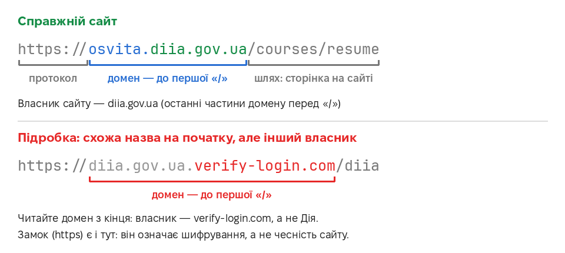

**Замок** біля адреси (https) означає, що дані між вами і сайтом **зашифровані**. Але він **не гарантує**, що сайт чесний: шахрайські сайти теж бувають із замком. Тому завжди перевіряйте сам домен.

### Фішинг

**Фішинг** — шахрайство, коли під виглядом банку, служби доставки чи держустанови у вас виманюють паролі, дані картки або коди з SMS. Ознаки:

- **поспіх і погрози**: «рахунок заблоковано», «лише 2 години»;
- **дивна адреса відправника** або посилання на чужий домен;
- **прохання ввести** пароль, номер картки, CVV чи **код з SMS** — справжній банк так ніколи не робить;
- помилки в тексті.

Якщо сумніваєтеся — не переходьте за посиланням, а самі відкрийте сайт чи застосунок банку або зателефонуйте за номером з картки.

### Паролі

- **Довжина важливіша за складність.** Добрий варіант — фраза з **4–5 випадкових слів**: `кіт-ракета-сир-хмара-ліс`.
- **Для кожного сайту — свій пароль.** Якщо один сайт зламають, решта лишаться в безпеці.
- Запам’ятати всі паролі неможливо — їх зберігає **менеджер паролів** (у Firefox він вбудований).
- Увімкніть **двофакторну автентифікацію (2FA)**: окрім пароля, сайт запитає ще й одноразовий код з телефона.

### Реклама і стеження

Разом із рекламою на сайти потрапляють **трекери** — невидимі програми, що стежать, які сайти ви відвідуєте. Реклама буває й небезпечною: фальшиві кнопки «Завантажити», фальшиві «знайдено вірус!». **Блокувальник реклами** (uBlock Origin) звіряє все, що завантажує сторінка, зі **списками фільтрів** — переліками відомих рекламних і стежувальних адрес — і не дає їм завантажитися. Сторінки стають чистішими й відкриваються швидше.

### Приватне вікно

**Приватне вікно** не зберігає на **цьому комп’ютері** історію, cookie і введені дані. Але воно **не ховає** вас від сайтів, від провайдера інтернету чи адміністратора мережі на роботі. Зручно, наприклад, щоб увійти у свою пошту на чужому комп’ютері.

**Хочете знати більше?** Необов’язково

На сторінці [**Детальніше**](more.md) — з прикладами, діаграмами й посиланнями на джерела:

- як адреса сайту перетворюється на число (DNS);
- що саме шифрує https;
- **що робити, якщо ви ввели дані на шахрайському сайті**;
- скільки часу потрібно, щоб підібрати пароль;
- як працюють коди двофакторної автентифікації;
- як працює uBlock Origin — з вимірюваннями;
- cookie, публічний Wi-Fi і оновлення.

У тесті цього матеріалу немає.

## Покроково

### 1. Вікно браузера

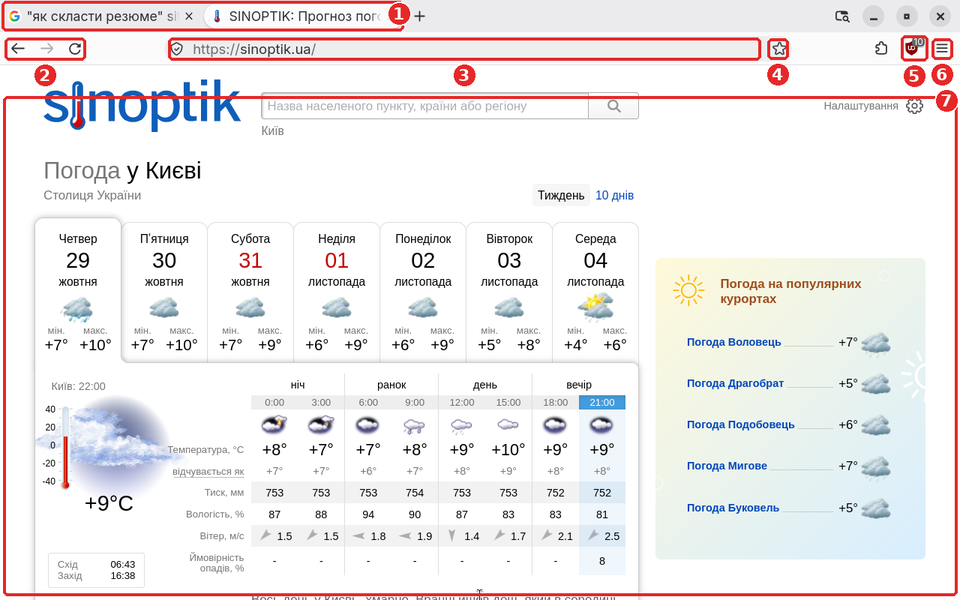

1. **Вкладки**: кілька сторінок в одному вікні.
2. **Назад, вперед, оновити сторінку**.
3. **Адресний рядок**: сюди вводять і адресу сайту, і пошуковий запит.
4. **Додати в закладки** (зірочка).
5. **uBlock Origin**: число показує, скільки заблоковано.
6. **Меню**: налаштування, паролі, історія, приватне вікно.
7. **Сторінка сайту**.

### 2. Шукаємо точніше

Введіть запит в адресному рядку і натисніть **Enter**. Щоб знайти точніше:

- **"лапки"** — шукати саме цю фразу, слово в слово;
- **site:gov.ua** — шукати лише на державних сайтах (так само `site:wikipedia.org` тощо);
- **мінус перед словом** (`резюме -шаблон`) — прибрати результати з цим словом.

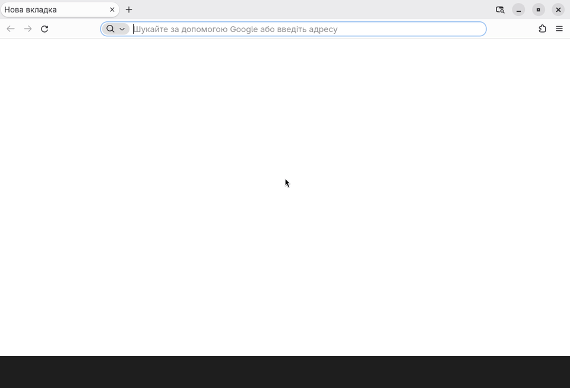

### 3. Вкладки

**Ctrl+T** — нова вкладка. Клацніть вкладку вгорі, щоб перейти до неї; хрестик — закрити. Закрили випадково? **Ctrl+Shift+T** відкриває її знову.

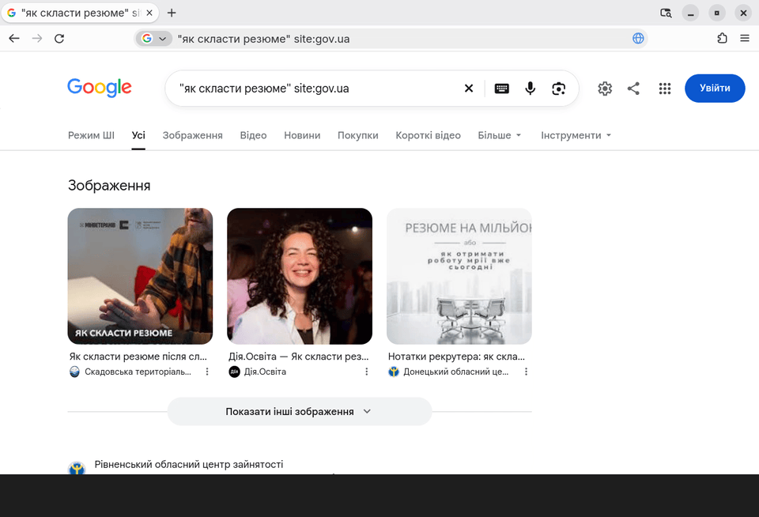

### 4. Закладки

**Зірочка** в адресному рядку додає сторінку до закладок. **Ctrl+Shift+B** показує панель закладок під адресним рядком — улюблені сайти завжди під рукою.

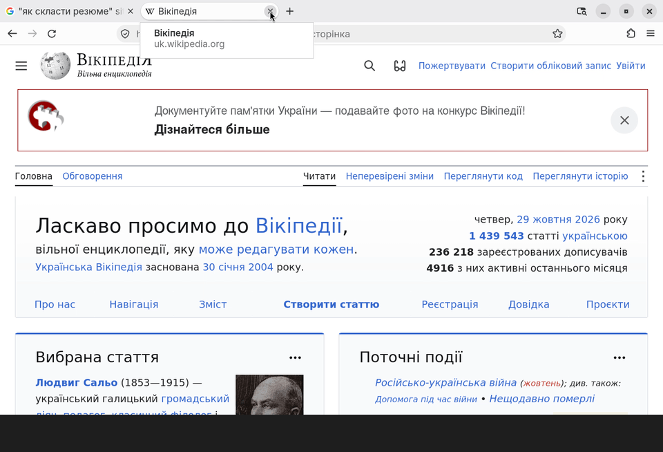

### 5. Приватне вікно

**Ctrl+Shift+P** відкриває приватне вікно (фіолетове, зі значком маски). Коли ви його закриєте, Firefox забуде історію, cookie і введені дані цього вікна.

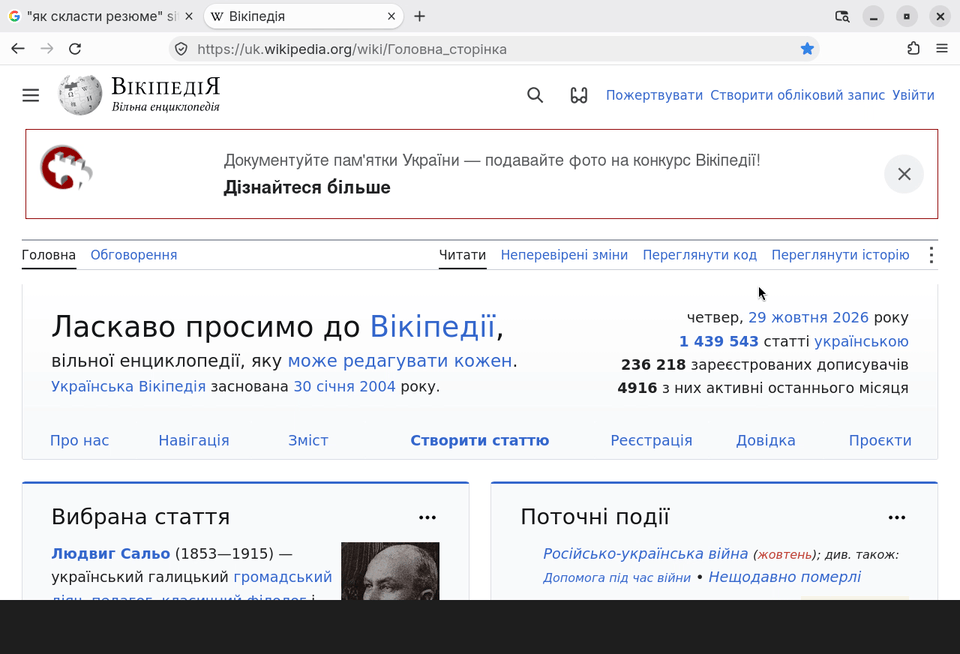

### 6. Перевіряємо адресу і з’єднання

Подивіться на **домен** в адресному рядку. Клацніть значок ліворуч від адреси → **Захищене з’єднання**: Firefox покаже, що з’єднання зашифроване і хто засвідчив сайт.

<video src="media/L3-06.mp4" autoplay loop muted playsinline aria-label="Перевірка домену і захищеного з’єднання"></video>

### 7. Розпізнаємо фішинговий лист

Ось вигаданий шахрайський лист від неіснуючого «ТвійБанку». Знайдіть ознаки:

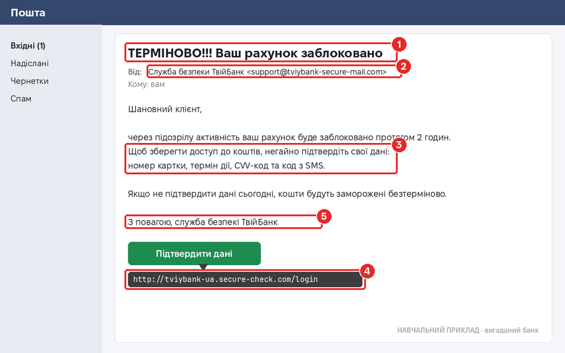

1. Поспіх і погрози в темі.
2. Адреса відправника — не домен банку.
3. Просять номер картки, CVV і код з SMS.
4. Кнопка веде на чужий домен (наведіть мишу на посилання — адресу видно внизу, не клацаючи).
5. Помилки в тексті.

### 8. Менеджер паролів

На сторінці реєстрації клацніть у полі **Пароль** — Firefox запропонує **надійний згенерований пароль** і сам його запам’ятає. Усі збережені паролі: **меню → Паролі**.

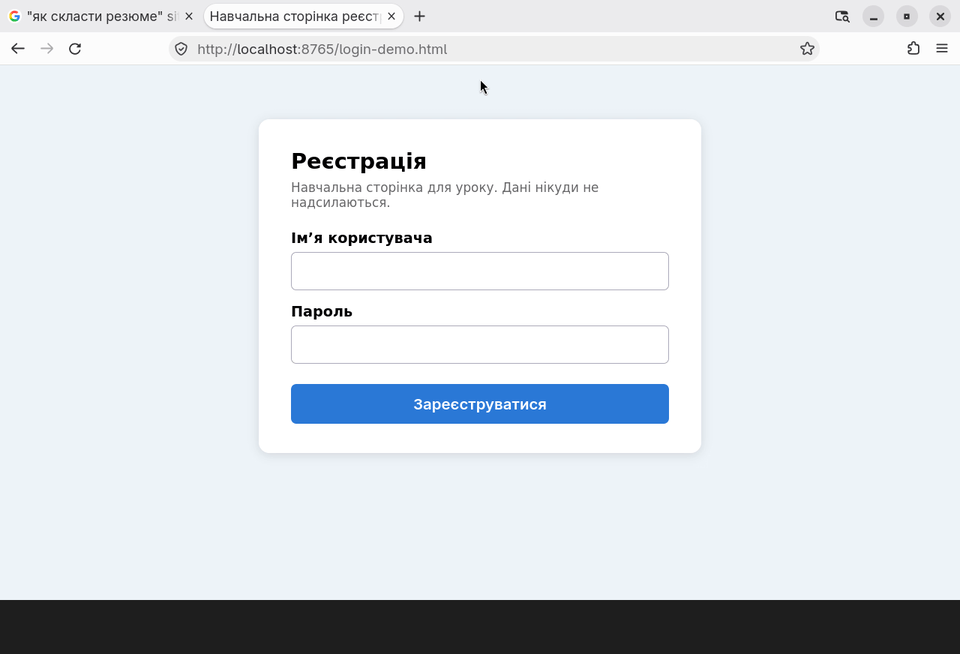

### 9. Встановлюємо блокувальник реклами

Відкрийте **офіційний каталог додатків Firefox** — addons.mozilla.org — і знайдіть **uBlock Origin**. Перевірте автора (**Raymond Hill**), позначку «Рекомендовані» й мільйони користувачів: існують підробки зі схожими назвами. Натисніть **Додати до Firefox** → **Додати**. Залиште галочку **Закріпити розширення на панелі** → **OK**.

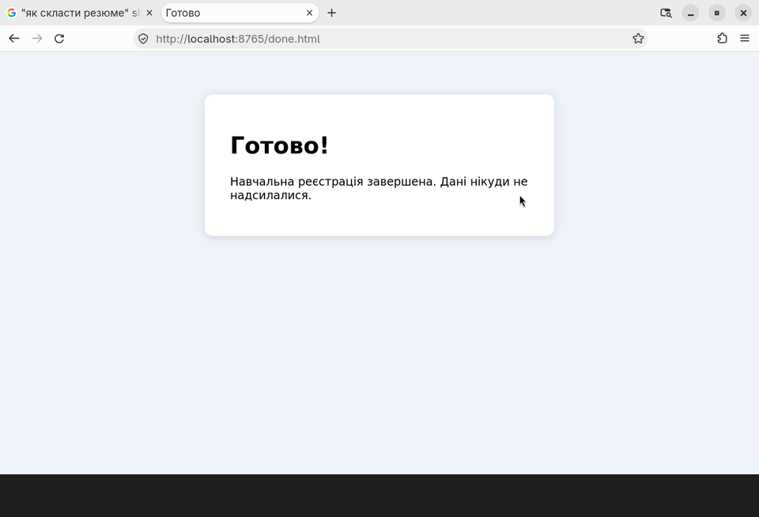

### 10. uBlock у роботі

Число на значку uBlock показує, скільки елементів заблоковано на цій сторінці. Клацніть значок — побачите подробиці.

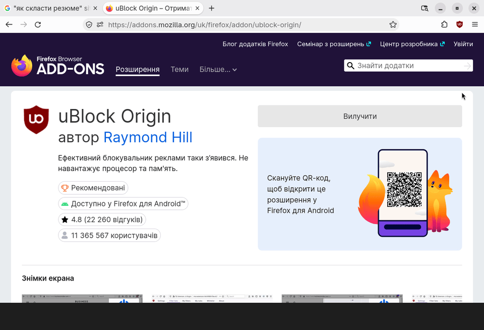

### 11. Вимикаємо блокування для одного сайту

Деякі сайти просять вимкнути блокувальник. Клацніть значок uBlock → велика **кнопка живлення** → оновіть сторінку (**F5**). Блокування вимкнеться **лише для цього сайту**. Увімкнути знову — так само.

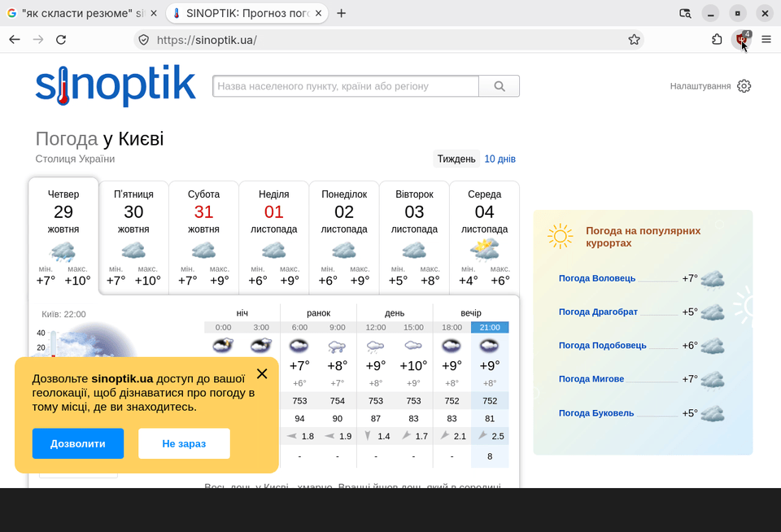

## Підсумок

- Власника сайту видно з **домену** — читайте його з кінця, до першої «/».
- **Замок** означає шифрування, а не чесність сайту.
- Банк **ніколи** не просить пароль, CVV чи код з SMS — це фішинг.
- Довгий **унікальний** пароль + **менеджер паролів** + **2FA**.
- **uBlock Origin** прибирає рекламу й трекери; встановлюйте розширення лише з офіційного каталогу.
- **Приватне вікно** не зберігає історію на комп’ютері, але не робить вас невидимим.

## Тест

10 запитань за матеріалом уроку (теорія та анімації на цій сторінці). На початку тесту вкажіть **прізвище, ім’я** та **групу**.

**[Пройти тест →](https://forms.gle/ZqwCKrL6dhkWkSnaA)**

## Додаткове завдання

Необов’язково Виконуйте, якщо маєте бажання. Надіслану роботу буде оцінено.

1. Знайдіть за допомогою `site:gov.ua` офіційну сторінку про будь-яку державну послугу. Надішліть посилання.
2. Які з цих адрес **підроблені**? Для кожної вкажіть справжній домен.
   - `https://tviybank.ua/`
   - `https://tviybank.ua.bonus-2026.com/`
   - `https://diia.gov.ua/services`
   - `https://diia-gov-ua.online/`
   - `https://login.kvitkabank.ua.security-check.net/`

   (ТвійБанк і КвіткаБанк — вигадані банки; їхні «справжні» адреси — `tviybank.ua` і `kvitkabank.ua`.)
3. Придумайте **фразу-пароль** з 5 випадкових слів (не використовуйте її насправді!) і поясніть, чому вона надійна.

**Як надіслати:** листом на адресу **cpto.bakhmut.925@gmail.com** ([написати лист](mailto:cpto.bakhmut.925@gmail.com)). Відповіді напишіть просто в тексті листа. У **темі листа** вкажіть прізвище, ім’я, групу і тему уроку, наприклад:

> Шевченко Оксана, група 21, Урок 3. Інтернет і безпека
