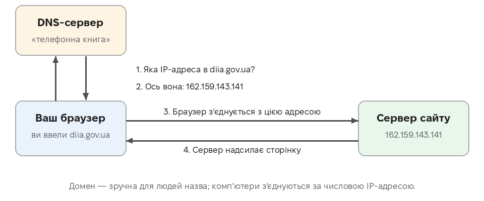
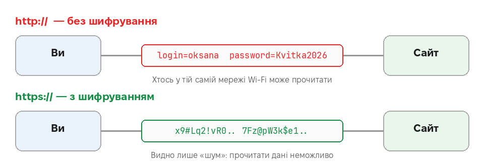
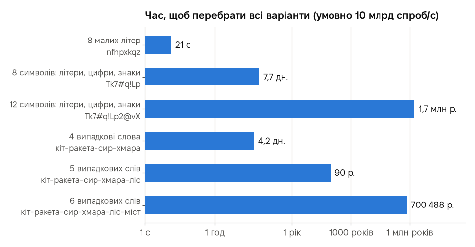
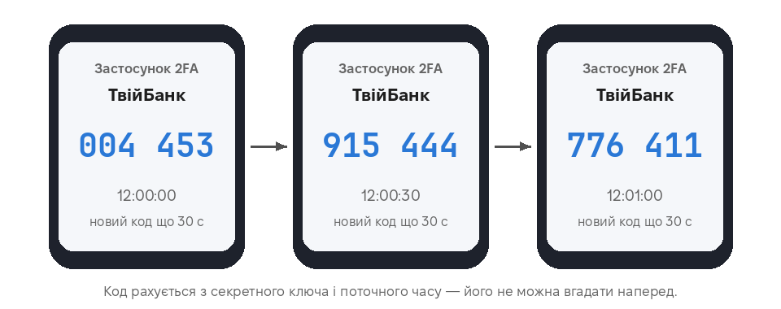
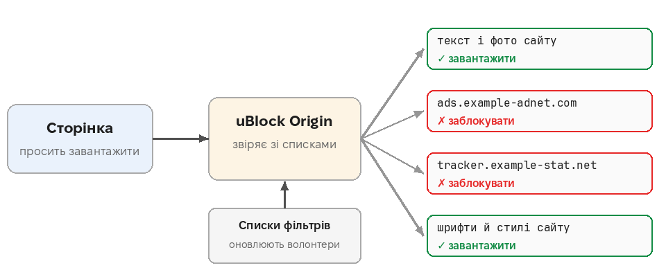
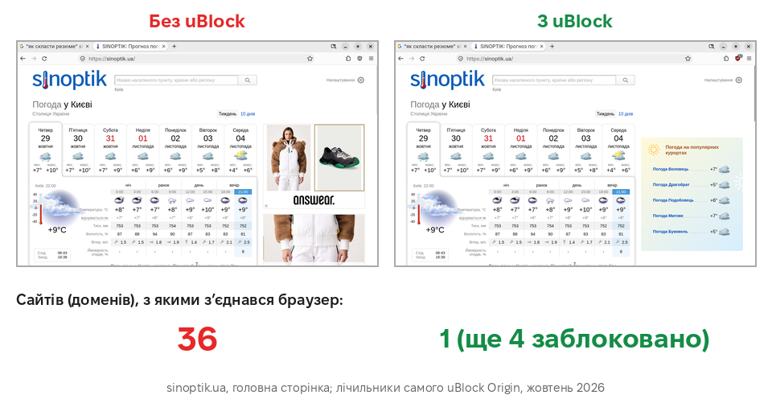

# Урок 3. Детальніше

Необов’язково Ця сторінка для тих, кому цікаво дізнатися більше про роботу інтернету й безпеку: з прикладами, діаграмами й посиланнями на джерела. **У тесті матеріалу цієї сторінки немає.**

[← Повернутися до уроку](index.md)

## 1. Як адреса знаходить сайт: DNS

Комп’ютери в інтернеті знаходять одне одного не за назвами, а за числовими **IP-адресами**. Перетворює назву на число **DNS** (система доменних імен) — своєрідна «телефонна книга» інтернету.

IP-адресу на схемі ми отримали справжнім запитом до DNS під час підготовки уроку. Великі сайти мають кілька адрес і можуть їх змінювати — тому людям і потрібні зручні назви.

**Джерела:**
[Вікіпедія: Система доменних імен](https://uk.wikipedia.org/wiki/Система_доменних_імен) ·
[Вікіпедія: IP-адреса](https://uk.wikipedia.org/wiki/IP-адреса) ·
[Вікіпедія: Доменне ім’я](https://uk.wikipedia.org/wiki/Доменне_ім'я)

## 2. Що саме шифрує https

Дані між вашим пристроєм і сайтом проходять через багато чужих пристроїв: роутер у кафе, обладнання провайдера, магістральні мережі. Без шифрування (**http**) кожен із них може прочитати, що ви вводите.

З **https** ті самі дані передаються **зашифрованими**. Сторонні бачать лише, **з яким сайтом** ви з’єднуєтеся, але не бачать сторінок, які ви відкриваєте, і того, що вводите.

Чого https **не робить**: не перевіряє, чи сайт чесний. Шахраї легко отримують сертифікат для свого домену — і в них теж буде замок. Тому головне — перевіряти **домен** (див. урок).

**Джерела:**
[Вікіпедія: HTTPS](https://uk.wikipedia.org/wiki/HTTPS) ·
[Довідка Firefox: Як мені визначити чи безпечне з’єднання з вебсайтом?](https://support.mozilla.org/uk/kb/how-do-i-tell-if-my-connection-is-secure)

## 3. Що робити, якщо ви ввели дані на шахрайському сайті

Діяти треба **швидко** — кожна хвилина важлива.

| Що ввели | Що робити одразу |
|---|---|
| **Дані картки, CVV або код з SMS** | Зателефонуйте в банк за номером **з картки** (не з листа!) і **заблокуйте картку**. Перевірте останні операції. |
| **Пароль від пошти чи соцмережі** | Змініть пароль на **справжньому** сайті. Якщо такий самий пароль був на інших сайтах — змініть і там. Увімкніть 2FA. |
| **Код для входу (з SMS чи застосунку)** | Увійдіть на справжній сайт, завершіть усі сеанси («вийти на всіх пристроях»), змініть пароль. |
| **Встановили щось із посилання** | Від’єднайте пристрій від інтернету, перевірте його антивірусом; паролі змінюйте з **іншого**, чистого пристрою. |

Потім:

- **Повідомте близьких**, якщо зламали месенджер чи соцмережу: шахраї часто просять у друзів «позичити гроші».
- **Повідомте кіберполіцію** — на сайті Департаменту кіберполіції є форма звернення.
- Перевірте, чи ваша пошта не потрапляла у відомі витоки даних (сервіс **Have I Been Pwned**).

**Джерела:**
[Вікіпедія: Фішинг](https://uk.wikipedia.org/wiki/Фішинг) ·
[Департамент кіберполіції Національної поліції України](https://cyberpolice.gov.ua/) ·
[CERT-UA — урядова команда реагування на комп’ютерні надзвичайні події](https://cert.gov.ua/) ·
[Have I Been Pwned (англ.)](https://haveibeenpwned.com/)

## 4. Скільки часу потрібно, щоб підібрати пароль

Якщо зловмисники викрадуть базу паролів сайту, вони перебирають варіанти на потужних комп’ютерах. Ми порахували, скільки часу знадобиться, щоб перебрати **всі можливі** варіанти, якщо перевіряти **10 мільярдів паролів за секунду** (умовне число; справжня швидкість залежить від того, як сайт зберігає паролі):

| Пароль | Варіантів | Час перебору |
|---|---|---|
| 8 малих літер | 26⁸ ≈ 2·10¹¹ | 21 секунда |
| 8 символів: літери, цифри, знаки | 95⁸ ≈ 7·10¹⁵ | 7,7 доби |
| 12 символів: літери, цифри, знаки | 95¹² ≈ 5·10²³ | 1,7 млн років |
| 4 випадкові слова зі списку 7776 слів | 7776⁴ ≈ 4·10¹⁵ | 4,2 доби |
| 5 випадкових слів | 7776⁵ ≈ 3·10¹⁹ | 90 років |
| 6 випадкових слів | 7776⁶ ≈ 2·10²³ | 700 тис. років |

Висновки:

- **Кожен додатковий символ чи слово множить час**, тому довжина важливіша за «складність».
- Фраза з **5–6 випадкових слів** надійна і легко запам’ятовується.
- Слова мають бути **справді випадковими** (наприклад, кинути кубики за методом Diceware), а не цитатою чи рядком з пісні — такі фрази є в словниках зловмисників.
- Найслабші — **поширені** паролі (`123456`, `qwerty`, `password`): їх підбирають миттєво, бо з них починають.

**Джерела:**
[NIST SP 800-63B: Digital Identity Guidelines (англ.)](https://pages.nist.gov/800-63-4/sp800-63b.html) ·
[EFF: Dice-Generated Passphrases (англ.)](https://www.eff.org/dice) ·
[CISA: Use Strong Passwords (англ.)](https://www.cisa.gov/secure-our-world/use-strong-passwords) ·
[Вікіпедія: Менеджер паролів](https://uk.wikipedia.org/wiki/Менеджер_паролів) ·
[Довідка Firefox: Менеджер паролів](https://support.mozilla.org/uk/kb/password-manager-remember-delete-edit-logins)

## 5. Як працюють коди двофакторної автентифікації

**Двофакторна автентифікація (2FA)** вимагає дві різні речі: те, що ви **знаєте** (пароль), і те, що у вас **є** (телефон). Навіть якщо пароль украдуть, без телефона увійти не вийде.

Найпоширеніший спосіб — **застосунок-автентифікатор** (наприклад, Aegis чи FreeOTP — вони з відкритим кодом). Під час налаштування сайт і застосунок обмінюються **секретним ключем** (зазвичай через QR-код). Далі кожні **30 секунд** обидва незалежно рахують новий 6-значний код із ключа і поточного часу:

Коди на малюнку справжні: ми порахували їх за стандартним алгоритмом TOTP для демонстраційного ключа. Код діє лише півхвилини, тому навіть підглянутий код швидко стає непотрібним.

Коди з **SMS** теж краще, ніж нічого, але застосунок надійніший: SMS можна перехопити, підмінивши SIM-картку.

**Джерела:**
[Вікіпедія: Багатофакторна автентифікація](https://uk.wikipedia.org/wiki/Багатофакторна_автентифікація) ·
[Вікіпедія: TOTP](https://uk.wikipedia.org/wiki/TOTP) ·
[RFC 6238: стандарт TOTP (англ.)](https://datatracker.ietf.org/doc/html/rfc6238)

## 6. Як працює uBlock Origin

Сторінка сайту складається з десятків окремих частин: тексту, фото, шрифтів, а також реклами й трекерів з **інших** сайтів. Перед завантаженням кожної частини uBlock звіряє її адресу зі **списками фільтрів** — переліками відомих рекламних і стежувальних адрес, які підтримують волонтери (наприклад, EasyList, EasyPrivacy). Збіг — частина не завантажується. Місця, що лишилися порожніми, uBlock ховає.

### Вимірювання

Ми відкрили ту саму сторінку прогнозу погоди без uBlock і з ним та подивилися на лічильники самого uBlock:

| | Без uBlock | З uBlock |
|---|---|---|
| Доменів, з якими з’єднався браузер | **36** | **1** (ще 4 заблоковано) |
| Реклама на сторінці | є | немає |

Тобто без блокувальника ваш браузер «спілкувався» з **36** різними компаніями, щоб показати одну сторінку погоди. Кожна з них дізналася, що ви її відкрили.

uBlock Origin — **з відкритим кодом** і не бере грошей у рекламодавців за «дозволену рекламу». Встановлюйте лише з офіційного каталогу: у магазинах розширень трапляються підробки зі схожими назвами.

**Джерела:**
[uBlock Origin на GitHub (англ.)](https://github.com/gorhill/uBlock) ·
[Довідка Firefox: Знаходьте та встановлюйте додатки](https://support.mozilla.org/uk/kb/find-and-install-add-ons-add-features-to-firefox) ·
[Довідка Firefox: Розширений захист від стеження](https://support.mozilla.org/uk/kb/enhanced-tracking-protection-firefox-desktop)

## 7. Cookie

**Cookie** (кукі) — маленькі записи, які сайт зберігає у вашому браузері. Корисні cookie пам’ятають, що ви увійшли в обліковий запис, обрану мову, вміст кошика.

**Сторонні cookie** ставлять не сам сайт, а рекламні мережі, вбудовані в нього. Так одна мережа впізнає вас на сотнях різних сайтів і складає ваш «профіль інтересів». Firefox типово обмежує такі cookie (Розширений захист від стеження), а приватне вікно видаляє всі cookie після закриття.

**Джерела:**
[Вікіпедія: Кукі (інтернет)](https://uk.wikipedia.org/wiki/Кукі_(інтернет)) ·
[Вікіпедія: Сторонні кукі](https://uk.wikipedia.org/wiki/Сторонні_кукі) ·
[Довідка Firefox: Приватний перегляд](https://support.mozilla.org/uk/kb/private-browsing-use-firefox-without-history)

## 8. Публічний Wi-Fi і оновлення

**Публічний Wi-Fi** (кафе, вокзал, готель):

- Відкриті мережі може «прослуховувати» будь-хто поруч, а шахраї іноді створюють мережу з назвою, як у закладу. Уточнюйте назву мережі в персоналу.
- Відкривайте лише сайти з **https**; для банку краще використовувати мобільний інтернет.
- Вимкніть автоматичне підключення до відкритих мереж.

**Оновлення** браузера, системи й застосунків закривають **знайдені вразливості** — дірки, через які шкідливі сайти можуть заразити пристрій. Не відкладайте їх: шахраї активно використовують саме старі, вже відомі вразливості.

**Джерела:**
[CERT-UA: новини і рекомендації з кібербезпеки](https://cert.gov.ua/) ·
[CISA: Use Strong Passwords (англ.)](https://www.cisa.gov/secure-our-world/use-strong-passwords)

---

[← Повернутися до уроку](index.md)
