# Урок 4. Основи програмування та робота зі ШІ

<div class="how-to">

**Як працювати з уроком**

1. Прочитайте теорію. Сторінку «Детальніше» відкривайте, якщо цікаво.
2. Перегляньте анімації: кожна показує одну дію крок за кроком.
3. Пройдіть [тест](#тест) (10 запитань). На початку вкажіть прізвище, ім’я та групу.
4. За бажанням виконайте [додаткове завдання](#додаткове-завдання). Воно необов’язкове, але якщо ви його надішлете, воно буде оцінене.

</div>

## Мета уроку

Ви:

- напишете й запустите кілька маленьких програм мовою **Python** у редакторі **Geany**;
- навчитеся читати повідомлення про помилку;
- побачите, як **ШІ-помічник** пояснює код, шукає помилки й допомагає змінити програму — і чому його відповіді треба перевіряти.

## Що знадобиться

- **Python** — безкоштовний, з відкритим кодом.
  - Windows: встановіть **Python install manager** з офіційного сайту **python.org** (розділ Downloads) або з Microsoft Store. Після встановлення команда `python` працює сама, нічого додатково налаштовувати не треба.
  - Linux: Python зазвичай уже встановлено.
- **Geany** — простий редактор коду, безкоштовний, з відкритим кодом: **geany.org**. Він сам запускає програми Python.
- Для частини про ШІ — браузер і сайт **duck.ai** (безкоштовно, без реєстрації).
- Файли для вправ: [calc.py](files/calc.py) (калькулятор), [buggy.py](files/buggy.py) (та сама програма з двома помилками).

## Теорія

### Програма

**Програма** — це точна послідовність команд для комп’ютера, як рецепт. Комп’ютер виконує команди **буквально і по черзі**, тому кожна дужка й лапка важлива. Опис того, як розв’язати задачу крок за кроком, називають **алгоритмом**.

Майже будь-яка програма робить три речі: **отримує дані → обробляє їх → показує результат**.

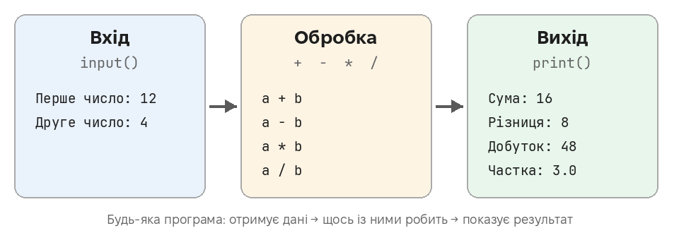

**Python** — одна з найпопулярніших мов програмування. Її люблять новачки: команди схожі на звичайні англійські слова, а програма з одного рядка вже працює.

| Команда | Що робить |
|---|---|
| `print("Привіт")` | показує текст на екрані |
| `name = input("Як вас звати? ")` | питає користувача; відповідь зберігається у **змінній** `name` |
| `int(...)` | перетворює введений текст на число, щоб із ним рахувати |
| `if … :` / `else:` | «якщо … то …, інакше …»; рядки з відступом (4 пробіли) належать до свого випадку |

Файл програми Python має розширення **.py**.

### ШІ-помічник

**ШІ-чат** (Duck.ai, ChatGPT, Gemini тощо) — програма, яка навчилася на величезній кількості текстів і **передбачає**, які слова найкраще продовжать розмову. Вона добре пояснює, підказує й пише чернетки. Але:

- **ШІ може помилятися впевнено** — вигадувати факти чи код, що не працює. Це називають **«галюцинаціями»**. Перевіряйте факти й **завжди запускайте код**.
- **Не вводьте в чат особисті дані**, паролі, дані карток, робочі секрети.
- **У навчанні** використовуйте ШІ як **репетитора**, а не як того, хто робить завдання за вас. Дотримуйтеся правил викладача.

Чим краще сформульовано запит, тим корисніша відповідь:

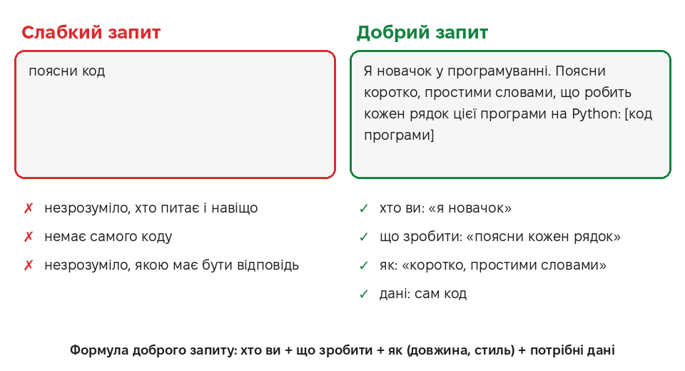

<div class="more-link">

**Хочете знати більше?** <span class="optional">Необов’язково</span>

На сторінці [**Детальніше**](more.md) — з прикладами, діаграмами й посиланнями на джерела:

- та сама програма п’ятьма мовами програмування;
- що таке інтерпретатор і наскільки швидкий Python (з вимірюваннями);
- правила для назв змінних — зі справжніми повідомленнями Python;
- як ШІ «пише» текст і чому відповідає щоразу інакше;
- ШІ з відкритим кодом на власному комп’ютері;
- що відбувається з тим, що ви пишете в чат.

У тесті цього матеріалу немає.

</div>

## Покроково: програмування

### 1. Вікно Geany

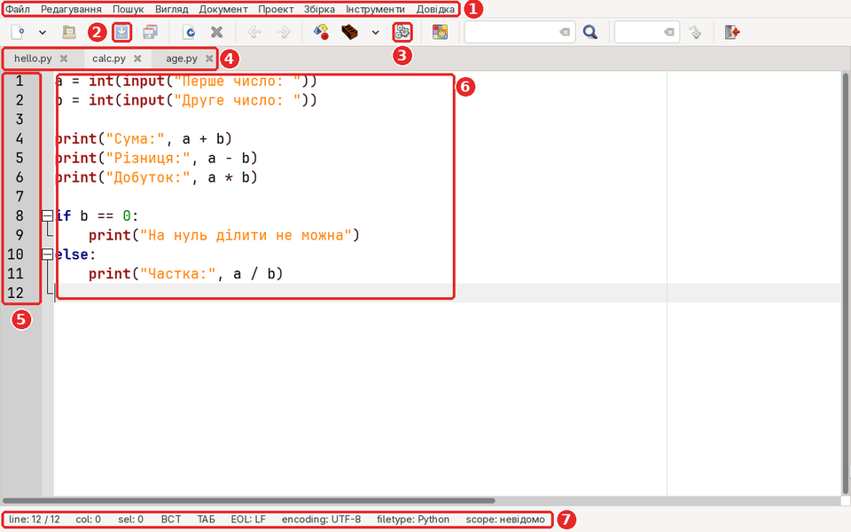

1. **Меню**.
2. **Зберегти** (Ctrl+S).
3. **Виконати** програму (F5).
4. **Вкладки** відкритих файлів.
5. **Номери рядків** — вони згадуються в повідомленнях про помилки.
6. **Код програми**: Geany розфарбовує команди, текст і числа.
7. **Рядок стану**: номер рядка, тип файлу (Python).

### 2. Створюємо файл програми

**Файл → Зберегти як…**, назва з розширенням **.py** (наприклад, `hello.py`). Тепер Geany знає, що це Python, і розфарбовує команди. Наберіть `print("Привіт, світе!")`.

<div class="clip">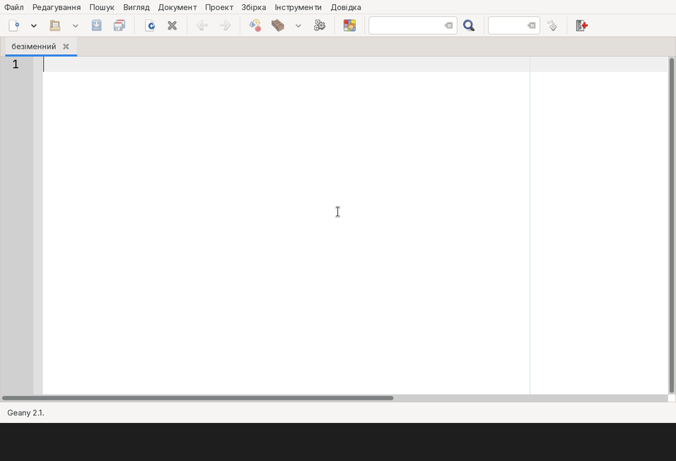</div>

### 3. Перша програма

Збережіть (**Ctrl+S**) і запустіть: кнопка **Виконати** або **F5**. Відкриється вікно з результатом. Нижче риски — службове повідомлення Geany; натисніть **Enter**, щоб закрити вікно.

<div class="clip"></div>

### 4. Змінні та введення

`input()` питає користувача і чекає, поки він введе відповідь і натисне Enter. Відповідь зберігається у **змінній** — `name` — і далі її можна використовувати.

```python
name = input("Як вас звати? ")
print("Привіт,", name)
```

<div class="clip">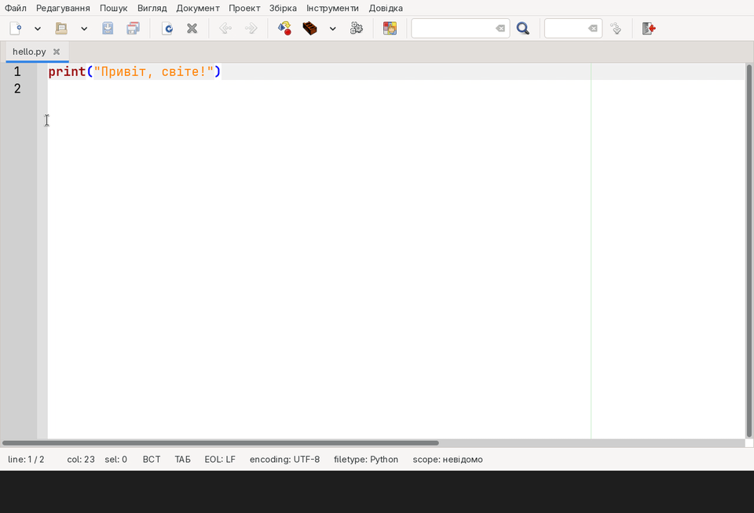</div>

### 5. Простий калькулятор

`input()` завжди повертає **текст**. Щоб рахувати, текст перетворюють на число функцією `int()`. Код — у файлі [calc.py](files/calc.py).

```python
a = int(input("Перше число: "))
b = int(input("Друге число: "))
print("Сума:", a + b)
print("Різниця:", a - b)
print("Добуток:", a * b)
print("Частка:", a / b)
```

<div class="clip">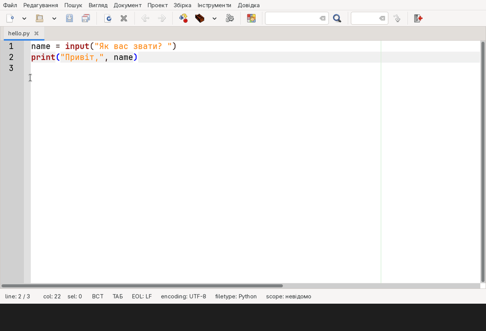</div>

### 6. Умова: якщо… інакше…

`if` перевіряє умову. Якщо вона виконується — працюють рядки з відступом під `if`, інакше — під `else`. **Відступ** (4 пробіли) у Python обов’язковий: так Python розуміє, які рядки до чого належать.

```python
age = int(input("Скільки вам років? "))
if age >= 18:
    print("Ви повнолітні")
else:
    print("Ви ще неповнолітні")
```

<div class="clip">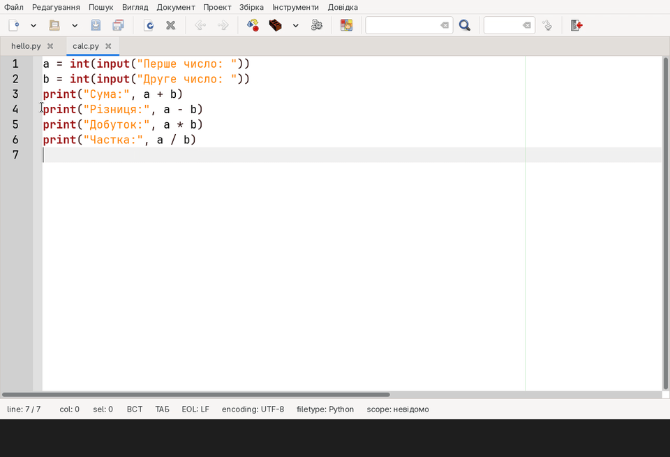</div>

### 7. Читаємо помилку

Помилки — це нормально, навіть у досвідчених програмістів. Python підказує, де шукати:

- **line 2** — номер рядка з помилкою;
- **^** — приблизне місце в рядку;
- **SyntaxError** — помилка в записі (забута дужка, лапка, кома); тут — `'(' was never closed`: дужку відкрили, але не закрили.

<div class="clip">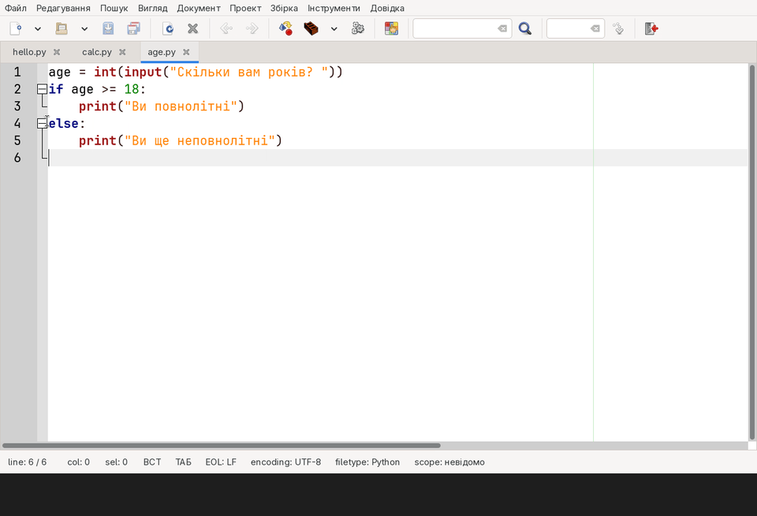</div>

## Покроково: ШІ-помічник

### 8. Відкриваємо Duck.ai

Відкрийте **duck.ai**. Реєстрація не потрібна. Напишіть запитання і натисніть **Enter**. Першого разу погодьтеся з умовами (**Продовжити**).

<div class="clip">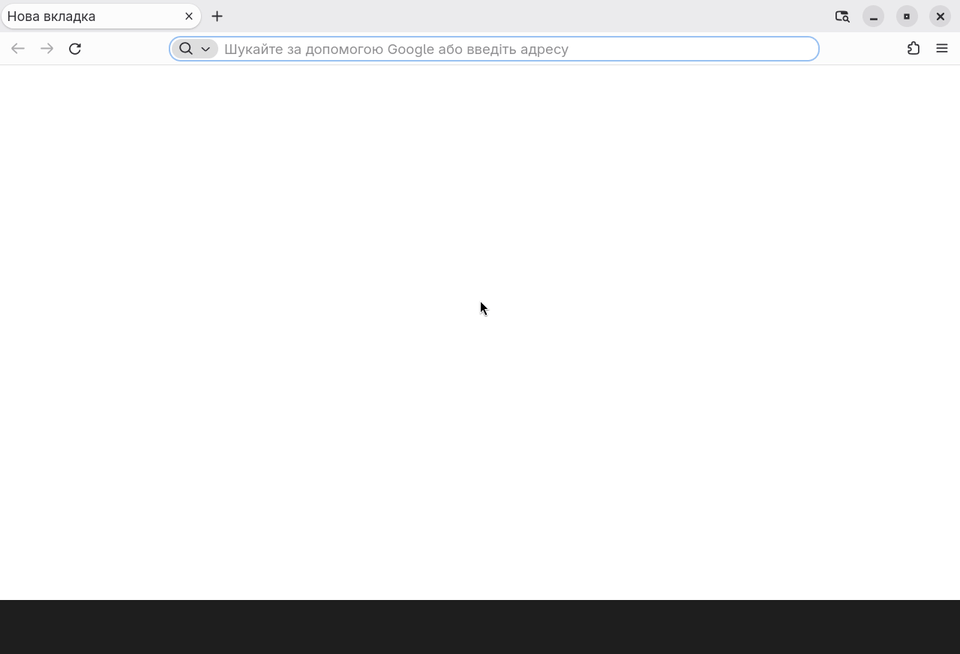</div>

### 9. ШІ пояснює код

**Новий чат** → напишіть, хто ви і що потрібно, і вставте код. Довгі очікування на анімації пропущено — насправді відповідь з’являється за 5–30 секунд.

<div class="clip">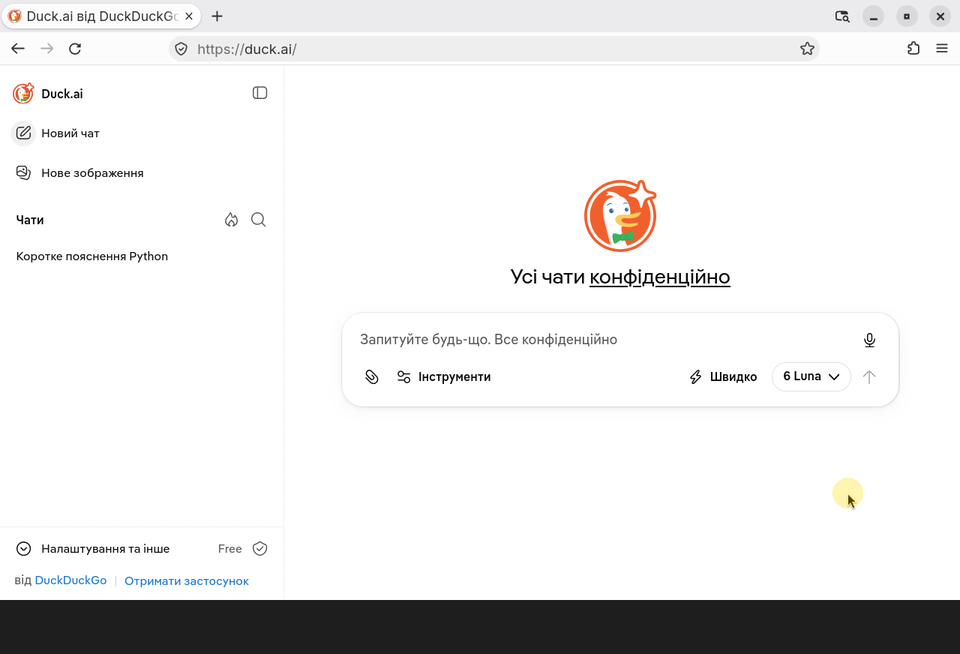</div>

### 10. ШІ шукає помилку

Вставте в запит **текст помилки** і **код** — так ШІ зрозуміє проблему. Порівняйте відповідь із тим, що каже Python, і **виправляйте самі**: так ви вчитеся.

<div class="clip">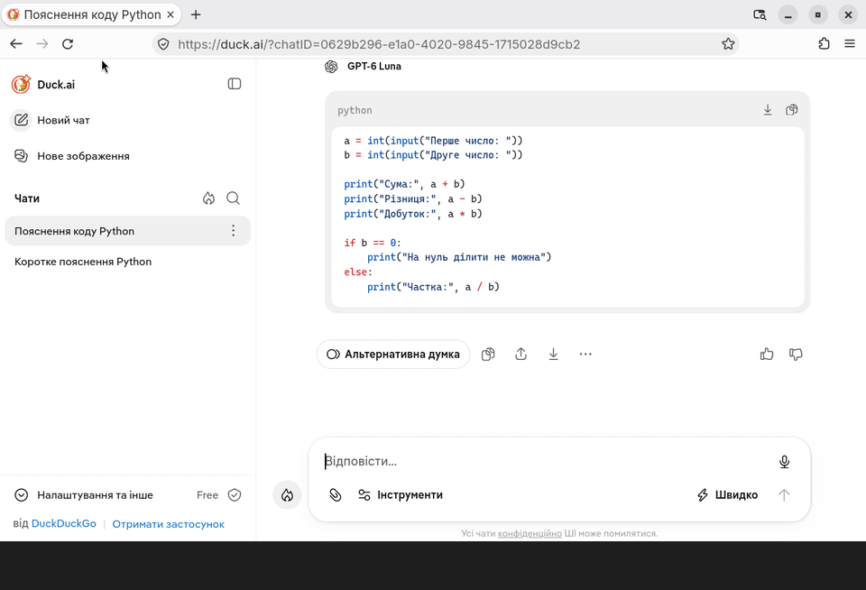</div>

### 11. ШІ змінює програму — а ми перевіряємо

У тому самому чаті попросіть змінити програму. Скопіюйте код кнопкою над ним, вставте в Geany, збережіть і **обов’язково запустіть**, перевіривши «незручний» випадок (тут — ділення на нуль).

<div class="clip">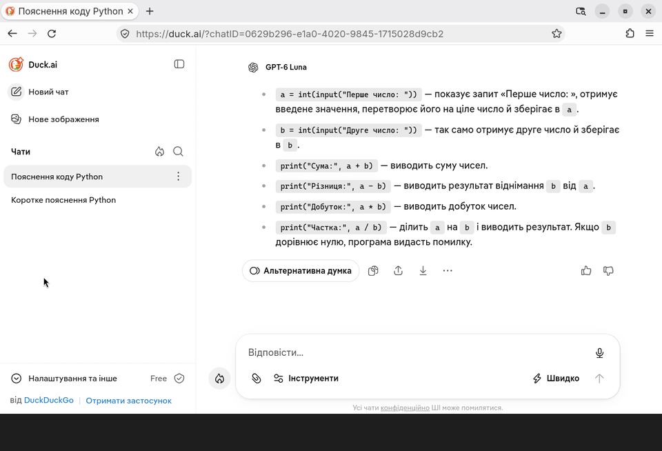</div>

### 12. ШІ для повсякденних задач

ШІ допомагає написати лист, оголошення, план. Не подобається відповідь — **уточніть** («коротше», «офіційніше», «простіше»). Перечитайте й виправте текст під себе перед надсиланням.

<div class="clip">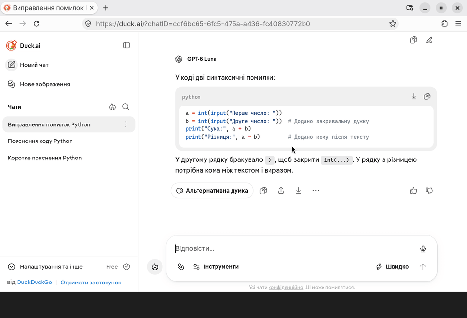</div>

## Підсумок

- Програма — точна послідовність команд; файл Python має розширення **.py**, запуск у Geany — **F5**.
- `print()` виводить, `input()` питає, `int()` перетворює текст на число, `if/else` обирає дію.
- Повідомлення про помилку показує **номер рядка** і тип помилки — читайте його, а не бійтеся.
- Добрий запит до ШІ: **хто ви + що зробити + як + потрібні дані**.
- ШІ може помилятися: **перевіряйте** факти й **запускайте** код. Не вводьте особисті дані.

## Тест

<div class="test-box">

10 запитань за матеріалом уроку (теорія та анімації на цій сторінці). На початку тесту вкажіть **прізвище, ім’я** та **групу**.

**[Пройти тест →](https://forms.gle/Xk2GWm2skzH81b519)**

</div>

## Додаткове завдання

<span class="optional">Необов’язково</span> Виконуйте, якщо маєте бажання. Надіслану роботу буде оцінено.

Напишіть програму, яка питає температуру в градусах Цельсія і виводить її у градусах Фаренгейта. Формула: **F = C × 9 / 5 + 32**. Перевірка: 20 °C = 68 °F, 0 °C = 32 °F.

Якщо щось не виходить — попросіть ШІ **пояснити помилку**, а не написати програму замість вас. Надішліть файл `.py` і, якщо користувалися ШІ, — ваш запит до нього.

**Як надіслати:** листом на адресу **cpto.bakhmut.925@gmail.com** ([написати лист](mailto:cpto.bakhmut.925@gmail.com)). Файл додайте до листа як вкладення. У **темі листа** вкажіть прізвище, ім’я, групу і тему уроку, наприклад:

> Шевченко Оксана, група 21, Урок 4. Основи програмування та ШІ
