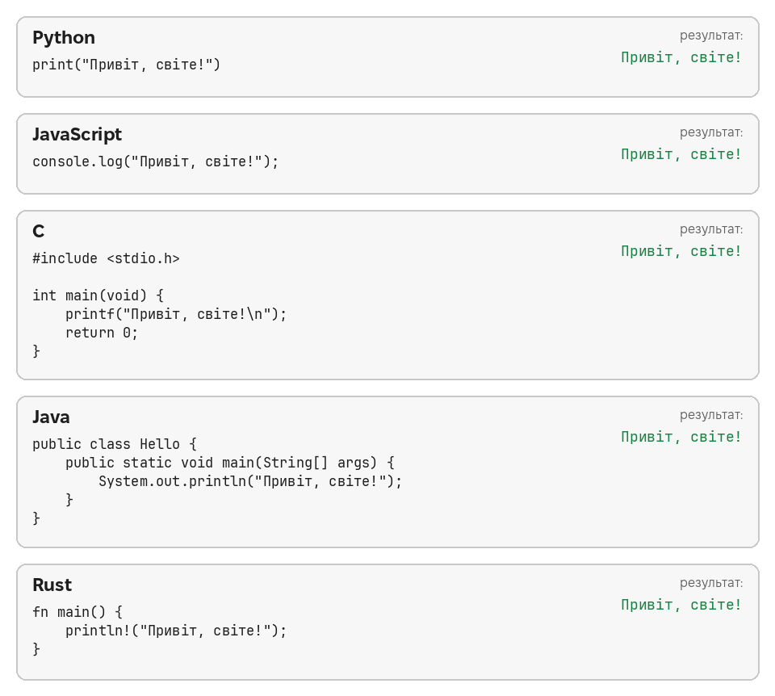
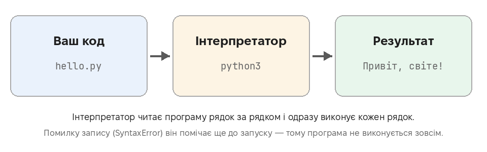
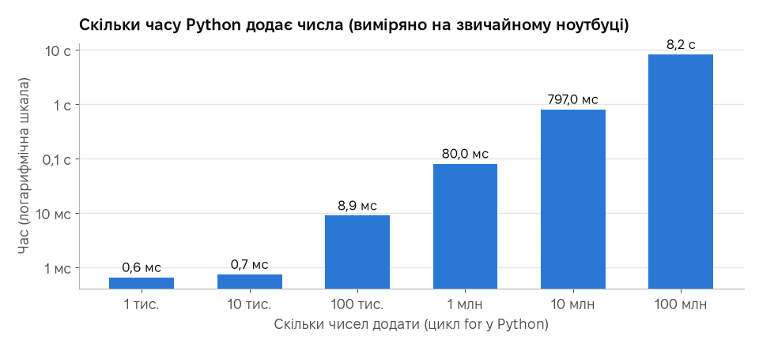
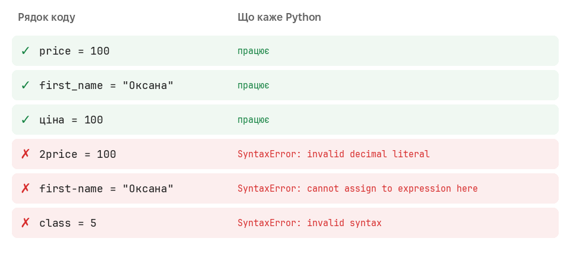
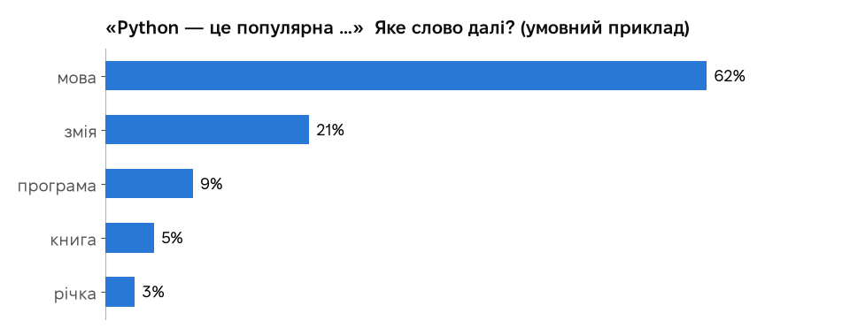
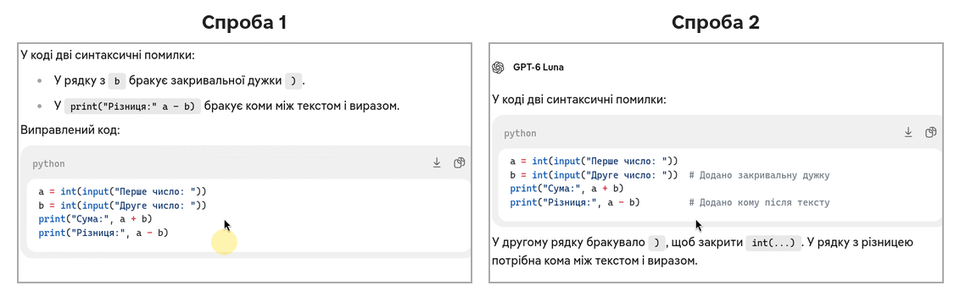
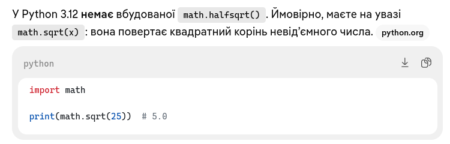

# Урок 4. Детальніше

Необов’язково Ця сторінка для тих, кому цікаво дізнатися більше про програмування і ШІ: з прикладами, діаграмами й посиланнями на джерела. **У тесті матеріалу цієї сторінки немає.**

[← Повернутися до уроку](index.md)

Усі приклади на цій сторінці справжні: програми запущено, час виміряно, відповіді ШІ — знімки екрана під час підготовки уроку.

## 1. Різні мови програмування

Мов програмування сотні, і кожна має свої сильні сторони. Ось одна й та сама програма п’ятьма мовами — ми скомпілювали й запустили кожну:

| Мова | Де найчастіше використовують |
|---|---|
| **Python** | навчання, аналіз даних, ШІ, автоматизація, сайти |
| **JavaScript** | сайти: усе, що «оживає» на сторінці у браузері |
| **C** | операційні системи, мікроконтролери, побутова техніка |
| **Java** | застосунки Android, великі системи банків і компаній |
| **Rust** | швидкі й надійні програми, де важлива безпека |

У Python програма — **один рядок**. В інших мовах треба більше «обв’язки», тому Python так зручний для перших кроків.

**Джерела:**
[Вікіпедія: Python](https://uk.wikipedia.org/wiki/Python) ·
[Вікіпедія: Мова програмування](https://uk.wikipedia.org/wiki/Мова_програмування) ·
[Підручник з Python (офіційний, укр.)](https://docs.python.org/uk/3/tutorial/index.html)

## 2. Інтерпретатор: хто виконує вашу програму

Комп’ютер сам не розуміє тексту `print("Привіт")`. Програму Python виконує **інтерпретатор** — програма `python`, яку ви встановили:

- **Інтерпретатор** (Python, JavaScript) читає програму і виконує її **одразу**.
- **Компілятор** (C, Rust, Java) спершу **перекладає** всю програму в машинний код, а потім уже готовий файл запускають. Так ми й робили з програмами C і Rust у розділі 1.

Саме тому, коли в рядку 2 бракує дужки, Python повідомляє про помилку ще **до** виконання першого рядка: перед запуском він перевіряє, чи правильно записано всю програму.

**Джерела:**
[Вікіпедія: Інтерпретатор](https://uk.wikipedia.org/wiki/Інтерпретатор) ·
[Вікіпедія: Компілятор](https://uk.wikipedia.org/wiki/Компілятор) ·
[Вікіпедія: Алгоритм](https://uk.wikipedia.org/wiki/Алгоритм)

## 3. Наскільки швидкий комп’ютер

Ми виміряли, скільки часу Python додає числа в циклі на звичайному ноутбуці:

| Скільки чисел | Час |
|---|---|
| 1 тисяча | менше 1 мс |
| 1 мільйон | 0,08 с |
| 10 мільйонів | 0,8 с |
| 100 мільйонів | 7,9 с |

Мільйон додавань — за **вісім сотих секунди**. При цьому Python — не найшвидша мова: та сама задача мовою C виконується в десятки разів швидше. Але для навчання й більшості щоденних задач швидкості Python із запасом вистачає, а писати програми ним набагато простіше.

**Джерела:**
[Вікіпедія: Python](https://uk.wikipedia.org/wiki/Python) ·
[Python Beginners Guide (англ.)](https://wiki.python.org/moin/BeginnersGuide)

## 4. Як називати змінні

**Змінна** — назва, під якою програма запам’ятовує значення. Правила Python:

- назва складається з **літер, цифр і `_`**, але **не починається з цифри**;
- **без пробілів і дефісів**: замість `first name` чи `first-name` пишуть `first_name`;
- не можна брати **зарезервовані слова** Python: `if`, `else`, `class`, `for`, `print` (останнє формально можна, але тоді команда `print` перестане працювати);
- великі й малі літери різняться: `Name` і `name` — дві різні змінні.

Що каже Python на справжні приклади (ми запустили кожен рядок):

Python дозволяє й українські назви (`ціна = 100`), але прийнято писати англійською: так код зрозуміють програмісти з усього світу. Добра назва пояснює, що в змінній: `price`, `user_age`, а не `x` чи `a1`.

**Джерела:**
[Вікіпедія: Змінна (програмування)](https://uk.wikipedia.org/wiki/Змінна_(програмування)) ·
[Документація Python: Лексичний аналіз — ідентифікатори (укр.)](https://docs.python.org/uk/3/reference/lexical_analysis.html#identifiers) ·
[PEP 8: правила оформлення коду Python (англ.)](https://peps.python.org/pep-0008/)

## 5. Як ШІ «пише» текст

ШІ-чати працюють на **великих мовних моделях**. Модель навчили на величезній кількості текстів, і вона вміє одне: **передбачати наступне слово** (точніше — шматочок слова). Відповідь складається слово за словом: модель щоразу оцінює, які продовження ймовірні, і обирає одне з них.

Звідси три важливі наслідки:

1. **Відповідь щоразу трохи інша.** Ми надіслали той самий запит про помилки в коді двічі (під час двох записів анімації). Зміст однаковий, формулювання й оформлення — різні:

   

2. **Модель не «знає», а продовжує текст правдоподібно.** Якщо правдоподібне продовження — неправда, вона може впевнено написати неправду. Це й називають **галюцинаціями**.

3. **Хороші моделі дедалі частіше чесно кажуть «такого немає».** Ми спитали про вигадану функцію `math.halfsqrt()` — ШІ відповів, що її не існує, і запропонував справжню:

   

   Але покладатися на це не можна. Перевіряйте факти в офіційних джерелах, а код — запуском.

**Джерела:**
[Вікіпедія: Велика мовна модель](https://uk.wikipedia.org/wiki/Велика_мовна_модель) ·
[Вікіпедія: Галюцинація (штучний інтелект)](https://uk.wikipedia.org/wiki/Галюцинація_(штучний_інтелект)) ·
[Вікіпедія: Чат-бот](https://uk.wikipedia.org/wiki/Чат-бот)

## 6. ШІ з відкритим кодом на власному комп’ютері

Більшість ШІ-чатів працюють на серверах компаній: ваш текст надсилається туди. Але є **відкриті моделі**, які можна запустити **на власному комп’ютері** — тоді дані нікуди не йдуть. Безкоштовні програми з відкритим кодом для цього:

- **Ollama** — запускає моделі однією командою;
- **Jan** — застосунок із вікном чату, схожим на звичні ШІ-сервіси.

Мінуси: потрібен потужний комп’ютер (бажано з 16 ГБ пам’яті), а невеликі локальні моделі помиляються частіше за великі онлайн-сервіси.

**Джерела:**
[Ollama (англ.)](https://ollama.com/) ·
[Jan (англ.)](https://jan.ai/)

## 7. Що відбувається з тим, що ви пишете в чат

Це залежить від сервісу — читайте його правила (Privacy Policy). Duck.ai, яким ми користувалися в уроці, прямо пише над кожним чатом:

Тобто DuckDuckGo приховує, від кого запит, і забороняє компаніям-розробникам моделей навчатися на ваших розмовах. В інших сервісах буває інакше: розмови можуть зберігатися й використовуватися для навчання нових моделей, а частину з них можуть читати працівники компанії.

Тому правило просте для будь-якого сервісу: **не пишіть у чат того, що не написали б незнайомій людині** — паролі, номери документів і карток, медичні дані, робочі секрети.

**Джерела:**
[Duck.ai: Privacy Policy and Terms of Use (англ.)](https://duckduckgo.com/duckai/privacy-terms) ·
[Міністерство цифрової трансформації України](https://thedigital.gov.ua/)

## 8. Встановлення Python у Windows: що змінилося

Раніше Python для Windows встановлювали інсталятором, де треба було не забути поставити галочку «Add python.exe to PATH». Починаючи з Python 3.14 цей інсталятор **застарів**, а з версії 3.16 його не випускатимуть. Тепер рекомендовано **Python install manager** (з python.org або Microsoft Store): він сам налаштовує команду `python`, і програми з Geany запускаються одразу.

**Джерела:**
[Документація Python: Використання Python у Windows (укр.)](https://docs.python.org/uk/3/using/windows.html) ·
[python.org: Downloads (англ.)](https://www.python.org/downloads/) ·
[Посібник Geany (англ.)](https://www.geany.org/documentation/manual/)

---

[← Повернутися до уроку](index.md)
